# Final project plan: mobile/web parity, reliable workflows, and current local data

Prepared 12 October 2026 for implementation. Repository: `/Users/saadaghbar/maher-aghbar-furniture-app`.

Execution-scope update, 13 October: the user excluded physical-device testing, then requested stopping testing and unnecessary work to conserve usage. See [essential continuation](/Users/saadaghbar/maher-aghbar-furniture-app/docs/PARITY-ESSENTIAL-CLOSURE-20261013.md). Remaining validation requirements below are deferred, not passed.

**This is an implementation handoff, not a claim that the application has been fixed.** Planning included source inspection, read-only local data inspection, representative browser walkthroughs, and the checks described below. Full native/device testing, exhaustive control testing, fixes, repairs, and retained order journeys are implementation deliverables.

Navigation: [decisions and baseline](#2-product-decisions-already-settled), [audit method](#6-audit-method-every-page-control-and-state), [navigation](#7-navigation-and-web-page-disposition), [contracts](#8-shared-frontenddomain-contracts), [orders/preparation](#9-orders-requests-quotations-and-preparation), [production](#10-production-workflow-and-scheduling), [workers/drivers](#11-worker-and-driver-experience), [other modules](#12-every-remaining-module), [data repair](#13-audit-and-repair-the-current-local-data), [test fixtures](#14-required-retained-uat-fixtures), [full walkthrough](#15-full-primary-order-walkthrough), [testing](#16-automated-tests-and-real-interaction-tests), [phases](#17-implementation-sequence-and-gates), [closure](#19-completion-gates-and-second-whole-project-review), [mobile inventory](#appendix-a-exhaustive-current-mobile-route-inventory), [web inventory](#appendix-b-exhaustive-current-web-route-inventory).

## 1. Implementation scope

> Implement this entire plan in the existing Maher furniture project. Read the complete document and its route appendices before editing. The outcome is a working frontend across web and mobile, with correct local data and production behavior. Use the mobile app as the reference for supported business capabilities and page journeys, while correcting defects in either client against the actual domain rules. Preserve both platforms' existing aesthetics. Web dashboards and module summary boards may have different visual layouts and compositions from mobile; their data, functional controls, permissions, and destinations must still be correct.
>
> Cover every production route, role, button, filter, form, sheet, tab, download, attachment, scan, navigation transition, and relevant state. Consolidate confusing web destinations and retain only justified specialist tools. Prioritize sales orders and their line/production children, preparation versus factory execution, and workers being offered work they can actually perform. Show all appropriate assigned work in My orders with specific waiting reasons; restrict Work now to executable actions.
>
> Work through the phases and gates in this document. Keep an auditable route/control matrix, defect register, data audit, test fixture registry, and evidence index. Inspect the actual running mobile app and website. Do not declare success from source inspection, passing terminal tests, route HTTP responses, or screenshots alone. Execute full business journeys through real browser and native interfaces, verify persisted outcomes, keep clearly labeled local test orders, then repeat the entire audit after the last fixes.
>
> Scope is the existing local database and local services. Preserve current business records, uploads, historical snapshots, and existing uncommitted work. Do not run demo resets, blanket reseeding, destructive cleanup, production deployment, or unsolicited external messages. Back up before repairs. Use isolated databases for destructive automated scenarios and additive retained fixtures in the current local database. Implement necessary API/domain corrections to support correct frontend behavior, and finish the visible interfaces as part of each fix.
>
> Treat historical closure documents and the current parity manifest as starting evidence, not completion proof. Resolve every route/control row with actual evidence or an explicit platform exception. Unknown or blocked testing remains incomplete. Continue until there are zero known reproducible in-scope functional defects, all required gates pass, and the second complete review is documented. If a real access/device blocker prevents a gate, report it precisely and leave that gate incomplete; never substitute a claim of success.

## 2. Product decisions already settled

| Decision | Required implementation |
|---|---|
| All roles | Cover administrators, production managers, warehouse and other configured staff, dealers/customers, production workers, inspectors/packers, and drivers. Use actual permission sets, including multiple-role users. |
| Mobile as reference | Match business meaning, supported actions, fields, filters, validation, and entity relationships. Mobile defects must also be repaired. Do not copy a faulty mobile heuristic into web. |
| Dashboards | Web home dashboards and module overview boards can differ visually from mobile. Keep useful visual summaries. Every functional element still needs correct data, scope, permission, and navigation. |
| Web extras | Keep a web-only tool only when it serves a real capability, has an intentional location, respects permissions, and passes actual tests. Consolidate duplicate destinations. Preserve equivalent capabilities before removing navigation. |
| Aesthetic | Keep the existing parchment/wood/board design language on both platforms. Change layout, grouping, copy, or controls when needed for clarity. No wholesale redesign. |
| Worker waiting work | My orders includes assigned work appropriate to the selected time scope, including unreleased or blocked work, visibly labeled with the reason. Work now contains only currently executable work. |
| Data | Audit and repair the current local database. Existing historical records matter. A fresh seed passing is insufficient. |
| Test orders | Add clearly labeled local UAT orders and retain them with a fixture registry. Do not contaminate real external communication or payments. |
| Completion | Full functional coverage, actual browser/native execution, data reconciliation, and a second complete review. No promise of mathematically proving absence of all future defects. |

## 3. Baseline and evidence boundaries

### 3.1 Current architecture

- Web is one Next.js application, `@maher/web`, on port 3000, with locale-prefixed admin, dealer, and worker portals. Older documents describing separate portal applications/ports are obsolete.
- Mobile is the Expo/React Native application. API is NestJS with Prisma/Postgres on port 4000. Metro uses 8081. The separate `apps/worker` service runs background jobs; it is not the employee UI.
- Shared permissions, types, translations, UI, workflow domain, and graph packages already exist. Extend these boundaries; do not import mobile screen implementations into Next.js.
- Factory calendar timezone observed in local data is **Asia/Amman**. Browser/device timezone must not silently redefine factory production days. Preserve date-only values separately from instants.
- There are 145 locale web `page.tsx` entries: 96 admin, 29 dealer, 12 worker, six auth, locale root, and legacy dashboard. There is also the non-locale root redirect. Mobile has 146 non-layout route files, including 14 developer routes. Route count is not feature count.
- The current manifest has 131 mobile mapping rows. Twenty-five target strings have no exact corresponding page file. Some are aliases or equivalent dynamic parameter names, not necessarily broken pages. Resolve them individually using the appendices.

### 3.2 Checks actually completed during planning

| Check | Observed result | Limit |
|---|---|---|
| Web test suite | 28 test files, 116 tests passed | Does not prove actual journeys or data correctness. |
| Web TypeScript check | Passed | Does not prove functional parity. |
| Representative browser inspection | Admin dashboard, sales order, production list/filter, worker home/orders/task, dealer dashboard and an order link | Not an exhaustive UI audit. |
| Current local data queries | Counts, statuses, selected relationships, release compatibility, worker eligibility signals | Not a full ledger, scheduling, or lifecycle reconciliation. |
| Native/mobile device execution | Not performed during planning | Mandatory implementation gate. |
| Data repair/test-order creation | Not performed during planning | Mandatory later work with backup and fixture registry. |

### 3.3 Read-only local snapshot

Observed snapshot, not fixed expected counts for future tests:

| Entity | Count |
|---|---:|
| Users | 20 |
| Customers | 3 |
| Sales orders | 57 |
| Production orders | 63 |
| Production tasks | 361 |
| RFQs | 52 |
| Quotations | 60 |
| Inventory lots | 42 |
| Deliveries | 26 |
| Invoices | 22 |
| Return requests | 3 |

Additional observations: 42 production orders have an explicit factory-release timestamp; 16 older started/on-floor orders lack that marker and need compatibility-aware classification. There are 39 unassigned open tasks and 145 assigned open tasks. Four assigned tasks belong to planned/unreleased work; assignment while preparing is valid. Initial checks found zero assigned open tasks with inactive/archived assignees, zero assigned open tasks without an active stage skill, zero sales-origin production orders missing their sales-order-line reference, zero production orders without tasks, zero missing workflow snapshots, and zero duplicate open time-entry groups per task. These results narrow the investigation; they do not certify the database.

Examples for read-only exploration: `SO-GOLDEN-001` has four lines/four production orders; `SO-2026-00029` has two/two; `SO-2026-00025` has three/three; `SO-2026-00036` has two/two. Locate by number at runtime and record UUIDs; never hardcode these as universal fixtures.

### 3.4 Verified findings and investigation candidates

| ID | Evidence | Required response |
|---|---|---|
| F01 | Browser: dealer dashboard order link uses `/en/orders/<id>`; full navigation redirected to `/en/admin/orders/<id>` and returned 404. Middleware treats legacy roots as admin roots. | Generate role-specific canonical links everywhere; test dealer dashboard clicks and deep links. Keep intended legacy compatibility without sending dealer links into admin. |
| F02 | Browser: after worker logout and dealer login, dealer shell/welcome still displayed the previous worker name; a full reload corrected it to the dealer identity. Source: shared `auth-me` cache has five-minute freshness; logout/login do not clear client query state. | Reset account-scoped client state on authentication transitions; verify same-tab account changes, pending requests, notifications, baskets, drafts, and permission-derived UI. Confirm with repeatable tests. |
| F03 | Web worker task buttons derive readiness mainly from task status/global dependency codes; API guards use release, actual snapshot prerequisites, ownership, inventory/WIP and action rules. | One authoritative action-capability contract; consume it on both platforms. |
| F04 | Worker home, My orders, order workflow, and detail use different projections/heuristics. Browser showed different count/status presentations across worker home and order list. | Define each counter's unit and scope; reconcile projections using the same task context. Do not assume all different counts should be equal. |
| F05 | Sales-order web `production-plan` mounts the older setup view, while mobile uses an item board and per-line production-plan editor. Some PO plan routes have no web equivalent. | Implement full preparation workspace and explicit line identity on web. |
| F06 | Plan board performs `POST ensure-plan` through query loading/refetch and uses first-task/index-based shortcuts. Mobile line-to-PO helper can fall back to first PO after an unresolved explicit line. | Separate read from authorized initialization mutations; remove ambiguous identity fallbacks and test reorder/invalid-ID behavior. |
| F07 | Web lifecycle helper examines first PO and treats commercial COMPLETED as delivered. Other production projections can imply delivery from factory completion. | Distinguish preparing, execution, factory completion, dispatch and receipt; aggregate all required lines. |
| F08 | Stage assignment query includes selected time window in request but not fully in cache key; date helpers can use browser-local day. | Include every request-affecting field in keys, use factory timezone, reject stale candidates at commit. |
| F09 | Web finish gating treats all unresolved blockers as prohibitions; API comments/behavior distinguish advisory blockers and hard BLOCKED state. | Expose action-specific hard and advisory reasons; preserve the distinction. |
| F10 | API start/resume/complete paths have different checks. Resume does not repeat all start checks. | Audit each transition for legitimate differences and bypasses; share required guards without imposing invented restrictions. Reproduce with integration and UI tests. |
| F11 | Existing parity tests largely verify rows/path substrings. Existing browser walk has guarded optional fixture branches and shallow route checks. Playwright CI job lacks its own complete service/fixture setup. | Build semantic/action tests, mandatory fixtures, and self-contained E2E infrastructure. |
| F12 | Several web extra routes already redirect to canonical areas. | Verify redirects and lost context; do not describe them all as extra live pages or delete useful destinations. |

Correction to avoid repeating a false finding: admin dashboard legacy links such as a sales-order scheduling link can work through middleware redirects; one was actually followed successfully. Such links need canonicalization and regression tests, not an unsupported blanket claim that they are all broken.

## 4. Domain model and invariants

### 4.1 Identity and hierarchy

| Entity | Meaning | Frontend rule |
|---|---|---|
| RFQ/request | Dealer request and factory review workspace | Keep request, quotation, and accepted order linked but distinct. |
| Quotation | Versioned commercial offer | Acceptance/revision must point to the correct request and generated sales order. |
| Sales order | Commercial parent, customer, prices, delivery commitment | Parent view summarizes all lines; parent actions never silently select a child. |
| Sales-order line | Ordered item/specification/quantity | Stable UUID and stored item letter, including AA and later letters. Use the immutable order specification snapshot. |
| Production order | Factory work for a particular line/origin | Display parent number and item letter; resolve by relation IDs. Return/rework/non-sales origins remain explicitly identified. |
| Stage instance/task | Runtime work in that PO's workflow snapshot | Assignment, dates, prerequisites, outputs, time, and permissions belong to that exact instance. |
| Delivery | Allocation/load/dispatch/receipt | Receipt evidence controls delivered presentation; factory completion alone does not. |

Use actual relation UUIDs, never array index, product ID, parsed display numbers, or the first PO as a substitute for explicit line identity. A parent can have multiple lines, a non-production line, or return/rework relationships. If an explicit line or PO does not belong to the parent, show an understandable invalid-selection state. Do not open another item. If several production orders genuinely belong to one line, display the relevant origin/revision choice instead of arbitrarily taking the first.

### 4.2 Distinct lifecycle boundaries

```mermaid
flowchart LR
  A[Request and review] --> B[Quotation and acceptance]
  B --> C[Commercial order]
  C --> D[Prepare each item]
  D --> E[Freeze or confirm plan]
  E --> F[Release to factory]
  F --> G[Execute eligible stages]
  G --> H[Quality and packaging]
  H --> I[Finished stock and delivery]
  I --> J[Dispatch]
  J --> K[Recorded receipt]
```

The diagram describes meanings; it does not replace actual status enums or supported exception transitions. Required rules:

1. Quote acceptance, commercial confirmation, plan creation, setup RELEASED status, actual factory release, and task start are separate events. Do not label all of them “Start production.”
2. `SalesOrderProductionSetup.status = RELEASED` alone is not proof that the work is on the factory floor. `releasedToFactoryAt` and documented legacy execution evidence determine floor classification.
3. `POST /sales-orders/:id/production-setup/release` freezes/releases preparation artifacts under the current design; do not assume it starts factory work. The PO start/release path is the factory boundary. Confirm exact current API effects before changing copy or guards.
4. A future planned factory start may release an order into a ready state without creating an active worker timer. Express those states clearly.
5. Parent summary aggregates all required child work. Mixed progress must be shown as mixed; a completed child cannot make its unfinished siblings or the whole order delivered.
6. Cancelled, on-hold, rejected, returned and rework paths need explicit labels. A cancellation cannot be represented as 100% successful fulfillment.
7. Date changes must preserve genuine lateness/history; do not rewrite historical dates to today to make warnings disappear.
8. Inventory, money and specification history remain auditable. Missing data is “missing/incomplete,” not a fabricated zero.

### 4.3 Hard requirements versus advisories

- Factory release uses the existing readiness model, including required executable-stage assignments, workflow validity, plan dates/setup and material-review requirements. Current `materialsReady` can be an advisory for PO release. Do not turn every soft material warning into a global release prohibition.
- Task execution still enforces the material/WIP requirements that apply to that particular action and stage.
- Open advisory blocker records do not automatically prohibit completion. Hard BLOCKED state and hard action reasons do.
- Inspection can be a quality decision with zero planned minutes. Do not invent fake duration, generic completion, or a timer solely to satisfy scheduling UI.
- Delivery/logistics stages do not belong in executable factory worker assignment requirements.
- Multiple tasks in progress for one worker are not automatically data corruption. Enforce actual supported concurrency policy and at most one running session per task; do not invent a one-task-per-worker rule.
- Completing without a running timer may be valid for some existing task types. Determine action-specific rules before imposing an IN_PROGRESS-only restriction.

## 5. Visual contract

Preserve the existing web Board primitives and mobile theme components. Refer to the web and mobile design documentation for the visual contracts.

| Platform | Preserve | Permitted improvements |
|---|---|---|
| Web | Existing Board primitives, warm paper, wood/olive/amber/sienna palette, header bands, 18px board shells and 8px ink stamps, restrained washes, authored data compositions | Better information hierarchy, clear item selection, combined workspaces, accessible controls and responsive composition. |
| Mobile | Parchment floors, 20px shells, 3px reading-start accent rails, inset metadata, existing board shadows, BottomSheet, AnimatedPressable, haptics and quiet transitions | Correct grouping/labels/actions; easier task readiness and waiting explanations; fixes to phone/tablet layouts. |
| Dashboards | Existing visual identity and useful platform-specific summaries | Web boards/charts can differ from mobile. Do not force pixel or dashboard layout parity. |

Do not mix mobile side rails into the web Board contract or replace mobile floors with generic SaaS cards. Reuse current list/detail/form/date/document/scan primitives. Do not resurrect retired UI components. Preserve existing visual contract tests. Capture representative before/after views in light/dark, Arabic/Hebrew RTL and English LTR, narrow and wide layouts. Codes, quantities, phone numbers and money retain correct bidirectional formatting. No new animation or design library is required for this project.

## 6. Audit method: every page, control, and state

Create an audit ledger before implementation. Start from appendices A–C, then expand each route into its actual mounted component, tabs, drawers, sheets, overlays and conditional branches. Mobile route files that redirect are navigation contracts, not independent screens to copy.

Audit shared layouts and shells separately: sidebar collapse/nested navigation, header/search/scan, theme/locale switches, user menu/logout, notification badges, role guards, loading/error/not-found/forbidden boundaries, global confirmations and unsaved-change handling. These can affect many routes without having their own `page.tsx` entry. Include tab content and modal-only workflows; route-file enumeration alone cannot establish coverage.

### 6.1 Required control record

Each record must contain: stable ID; role/permission set; mobile route and component; web route and component; entity/fixture IDs; locale/device; entry path; control label and control type; prerequisite state; enabled/disabled/hidden rule; API/query/mutation; expected visible result; expected persisted result; cross-client refresh effect; actual result; evidence link; defect ID; final disposition; final retest result.

Status vocabulary: `not inspected`, `inspected in source`, `observed in UI`, `failed`, `implemented—awaiting test`, `verified`, `intentional platform difference`, `blocked`. Never use `ported` as a substitute for verified behavior. An exception requires a reason, equivalent access if applicable, and proof that no supported business capability was lost.

### 6.2 Repeat this checklist for every route

| Area | Required exercises |
|---|---|
| Entry/exit | Real navigation click, deep link, refresh, back/forward, breadcrumb, parent/child transition, locale switch, notification/search/scan entry, unsaved edits. |
| Identity | Correct parent, line letter, product/spec snapshot, quantities, assignee, dealer scope, origin, dates and status. |
| Lists | All tabs/chips, every filter option, search, sort, combined filters, pagination, page-size, clear/reset, no matches, deletion/transition from current page. |
| Filters | Open/apply/cancel/clear, active count, restored state, query serialization, server semantics, count scope, browser history, cross-locale persistence. |
| Details | Every expansion/tab, graphs, timeline, images, files, related entities, read-only versus edit actions. |
| Forms | Every field, required/optional distinctions, numerical boundaries, decimals/units, invalid dates, dependent options, dirty/cancel/save/reopen, server errors and retries. |
| Actions | Permission gating, readiness gating, explanation, confirmation, pending state, double-click prevention, success/failure message, invalidation and persisted effect. |
| Data states | Initial load, slow network, empty data, long content, missing optional data, API error, 403, 404, stale state, simultaneous edits and expired session. |
| Overlays | Focus enters/returns, escape/backdrop, keyboard/touch reachability, scrolling, sheet chaining, no clipped footer or hidden action. |
| Documents/media | Preview/download/print, correct entity/version/locale, protected access, upload progress/failure, camera/file fallback, cancellation and duplicate attachment prevention. |
| Platform behavior | Native offline/outbox and reconnect; web online-required state; scan hardware/permissions; keyboard and screen reader; reduced motion. |

Every existing visible control must be enumerated from the running UI, even if not named in the module lists below. Every hidden conditional control must be exercised with a fixture that makes it appear. A clickable dashboard count is a functional filter/link and is included.

### 6.3 Comparison protocol

Use the same entities for paired read comparisons. For mutating comparisons, alternate platforms within a journey or create matched independent fixtures; do not attempt to complete the same task twice and call the second rejection a parity defect. Record both client result and API/database result. API calls assist diagnosis; they do not replace actually pressing the control. Validate list-to-detail and detail-to-list coherence after every important mutation.

## 7. Navigation and web-page disposition

### 7.1 Canonical architecture

- Admin keeps its dashboard and functional modules. Orders is the commercial desk; Production is factory work. Distinguish their primary questions in titles and breadcrumbs.
- Keep the visual `/admin/orders` overview if useful, with clear All orders and Customer requests access. Canonical commercial list/detail remains `/admin/sales-orders` and `/admin/sales-orders/[id]` rather than creating a competing detail under `/admin/orders/[id]`.
- Put specialist scheduling, workflow/stages, quality and problems under Production. Avoid duplicate primary nav items presenting them as different systems. Useful dashboard shortcuts may remain.
- Product-related material/fabric/specification management stays under Products where justified. Warehouses stay under Inventory; suppliers and fabric procurement stay under Purchasing; money tools stay under their account/invoice context.
- Dealer Orders links to request, quotation, accepted order, item progress and delivery clearly. Shop contains catalog/customization/basket/request creation. Money contains invoices/payments/statement; Account contains profile/security/preferences.
- Worker shell uses Home, My orders and Completed. Driver home is role-appropriate delivery work, not generic carpentry tasks. Shared notifications/profile remain accessible.
- Current public entry is authentication/role redirection, not a public storefront. Verify root and locale entry behavior; do not invent a new marketing site.

### 7.2 Specific disposition rules

| Current route/capability | Final disposition |
|---|---|
| `/admin/orders` visual overview | Keep as dashboard/commercial landing; give unambiguous work-list and request-inbox links. |
| `/admin/sales-orders/[id]/production-plan` | Canonical parent preparation workspace. With valid `lineId`, show that line's plan editor. Without it, show item board. |
| `/admin/production/[id]` | Canonical PO execution hub. Do not mix parent commercial edits and preparation controls indiscriminately into execution. |
| `/admin/production/[id]/plan` | Add equivalent direct PO plan access where needed, especially non-sales/return origins; route sales-origin preparation through its real parent/line. |
| Sales `/plan`, `/production-setup`, legacy mobile setup-line routes | Compatibility aliases to canonical preparation, preserving valid line/context/query parameters. Explicit invalid IDs must fail clearly. |
| Sales/PO `/flow` | Preserve useful flow visualization as a tab/section or deliberate deep link, not an additional competing detail. Resolve correct parent/line. |
| `/admin/users` | Existing redirect to Employees; keep compatibility and one visible Employees destination. |
| `/admin/departments`, `/roles`, `/audit` | Existing settings redirects; preserve requested section/tab context and prove equivalent functionality remains reachable. |
| `/admin/colors`, `/units`, `/categories` | Existing product redirects; preserve requested management context rather than losing the user's action. |
| `/admin/raw-materials`, `/production-stages` | Existing inventory/workflow redirects; verify final function and navigation. |
| `/admin/contracts`, `/documents` | Existing sales-order redirects; ensure relevant document/contract access is present in context. |
| `/admin/quality`, `/materials`, `/fabrics`, `/spec-options`, `/spec-option-values` | Keep useful management workspaces, nested intentionally with real data/actions and permission tests. |
| Dealer `/contracts`, `/documents` | Preserve useful access but consolidate under order/account document context; avoid competing first-level journeys. Test list/detail/download scope. |
| Dealer new-order/request variants | One coherent creation journey; preserve product prefill, basket, draft and custom-item modes. Aliases must retain parameters. |
| Native unlock, offline outbox and push-specific settings | Intentional platform differences. Provide honest web behavior; do not simulate unsupported offline execution. |
| Mobile `dev/*` | Developer-only surfaces; no production navigation or parity requirement. Ensure production access is excluded. |

Before removing a visible nav destination, list its unique capabilities, assign each to a canonical destination, verify those capabilities there, update all links, then retain appropriate compatibility redirects. A redirect must not silently discard filters, selected item, return location, or edit context. Reject unsafe external `next` URLs and role-incompatible return paths.

## 8. Shared frontend/domain contracts

### 8.1 Route and lifecycle contracts

Create/extend typed route builders for portal, locale, entity kind, parent/line/PO IDs, selected tab and return context. Use them in dashboards, lists, notification payload resolution, search, QR resolution and breadcrumbs. Remove ad hoc role-ambiguous href generation. Tests must follow final URLs and render the expected entity, not just assert string construction.

Create shared pure lifecycle projections in an appropriate existing shared package. Inputs must include all relevant children, origin, explicit/legacy release evidence, current execution, hold/cancellation, quality/packaging and delivery facts. Outputs should expose meaningful phase, per-line phase, mixed-state summary and reason. Do not share React components across mobile/web. Keep display copy translated in client/i18n layers. Add fixture-driven tests for mixed children, completed-not-delivered, future release, cancelled/held, no-production lines and legacy started records.

### 8.2 Authoritative task execution state

Add an additive typed task execution projection, tentatively `TaskExecutionState`, to existing shared API types. Design it around actual actions rather than one misleading `isActionable` boolean. Suggested semantic fields:

| Field | Meaning |
|---|---|
| Identity/version | Task, stage instance, PO, sales line/parent, evaluated-at and revision/freshness indicator. |
| Visibility | Assigned/open visibility, available date scope, remaining/completed context. |
| Phase | Working, can start, can resume, must receive first, waiting, hard blocked, awaiting quality decision, completed/cancelled. |
| Actions | Separate `canStart`, `canPause`, `canResume`, `canComplete`, `canReceive`, material/output actions, inspection submission, packaging confirmation, reassignment/override where relevant. |
| Reasons | Stable reason codes, hard/advisory classification, relevant stage/material/kit IDs and safe translated-message parameters. |
| Next step | Most useful allowed action or waiting explanation, including where an authorized manager resolves it. |

Required reason families: unreleased preparation, prior stage/parallel join incomplete, future planned day, hard hold/block, material shortage/reservation, WIP not ready/not received/claimed by someone else, unassigned/not yours, insufficient permission, task/stage terminal, QC route required, packaging labels missing, required completion evidence missing, and stale/conflicting state. These are a contract design checklist; use the actual domain's exact requirements and names.

Implement a side-effect-free evaluator using hydrated domain context and the same guard rules the mutation services enforce. Reuse actual workflow snapshot/DAG prerequisite resolution. Do not evaluate global stage definitions in place of order-specific edges. Do not call mutation methods in dry-run mode to infer capability. Batch dependencies, inventory, assignment and WIP context for lists; avoid an N+1 network/database check for every card/action. Include only authorized information.

Consume the projection consistently in task list/detail, worker home, My orders, order workflow, admin task detail, production task lists, and relevant report summaries. Mutation endpoints remain authoritative and re-evaluate within appropriate transaction/concurrency boundaries. UI capability can become stale; on a domain conflict, show the real human reason, refresh affected data and preserve valid user input. Never report success before persistence succeeds.

Unknown/loading capability disables irreversible task transitions until resolved, with a visible loading/error/retry state. This must not hide already assigned work. An unauthorized action should not appear usable; explanatory waiting text remains visible when appropriate. Do not disable benign navigation/inspection solely because execution is blocked.

Implementation order for this contract:

1. Trace existing mutation guards and document an action-by-action policy table with permitted task statuses and all required context. Add regression fixtures for current intended exceptions before consolidating checks.
2. Extend shared types with an additive execution-state DTO. Keep pure evaluation separate from database hydration, translation and React rendering. Use existing module conventions instead of introducing another service stack.
3. Hydrate context in batches in the API and reuse the evaluator in mutation validation where appropriate. Preserve atomic enforcement for mutable stock, WIP ownership and running sessions; a read projection cannot substitute for transaction-time checks.
4. Add consistent projections to `GET /api/v1/tasks`, `GET /api/v1/tasks/:id`, `GET /api/v1/tasks/my-orders`, `GET /api/v1/tasks/my-orders/:productionOrderId/workflow` and the worker-home reporting response where needed. Preserve existing response compatibility while migrating consumers. Confirm actual controller/DTO shapes before changing them.
5. Replace client status/global-dependency heuristics in both platforms. Render action-specific reasons and one primary next step; preserve read-only historical/context access.
6. Test projection/action agreement, direct-API bypass prevention, list query performance, stale conflicts and clients compiled against the updated DTO. Avoid issuing a separate readiness request per row when the list can return the required projection.

### 8.3 Queries, mutations and account isolation

1. Query keys include every response-affecting parameter: user/customer scope, entity, filters, pagination, factory date, selected time window and relevant permissions/context. Never cache an assignment candidate result under a different window.
2. All authentication boundaries cancel in-flight account requests and clear/reset account-scoped caches before displaying the next account. Hydrate the newly returned user identity. Resolve basket/draft storage by account: preserve the prior account's own draft safely, and never display/submit it as the new account's data.
3. Cover logout success/failure, expired session, failed login, portal mismatch, MFA, token refresh and multi-tab transitions. A local UI reset does not replace server logout/session invalidation.
4. Successful changes invalidate the relevant detail/list/dashboard/capability/schedule/inventory/notification queries across the affected entities. Cross-client mutations must converge through existing refresh/subscription behavior and explicit refetch; do not show permanent optimistic fiction.
5. Reserve initialization such as ensure-plan and ensure-stage-bins for explicit authorized, idempotent mutation flows. Reopening a read-only screen, focus refetch or polling must not create additional plans, tasks, bins, allocations or ledger entries.
6. Prevent duplicate submission and apply supported idempotency/concurrency checks at the server. Handle simultaneous workers/administrators honestly.

## 9. Orders, requests, quotations and preparation

### 9.1 Commercial desk and request review

Audit and repair these controls in both clients:

- All orders versus Customer requests modes; request inbox buckets including open/waiting/needs-info/quoted/drafts; sales lifecycle chips; dealer picker; status/priority/date/search filters; pagination and clear filters. Each badge's unit and denominator must be explicit.
- Request line selection, original photos/handwritten documents, AI extraction/review, dimensions/fabrics/extra materials/custom notes, factory feasibility, needs-information reason, dealer response, quotation creation/revision and navigation to linked quotation/order.
- Quote line edit, quantities, unit prices, tax/discount and total precision, cost hints, incomplete cost signals, acceptance/rejection/revision rules, PDF, attachments and supported notification actions. Acceptance must be idempotent and create/link the correct commercial parent exactly once.
- Draft editing/submission/cancellation, custom items and product-prefilled items. Keep custom order modifications separate from catalog templates. No temporary product/index selection may change another line's specification.
- Commercial order confirmation/payment requirements, priority, requested/promised delivery, end-customer/address fields and permissions. Distinguish estimated, requested and confirmed dates.

### 9.2 Parent sales-order detail

Use a clear identity board: commercial number, dealer/customer, commercial phase, external dealer number, dates and relevant hold reason. Show line cards with stored letters, image, order-specification summary, ordered quantity, fulfillment progress, current preparation/execution state and correct primary destination.

Consolidate redundant Production orders lists and repeated primary CTAs into one coherent item workspace. Keep necessary commercial totals/documents/schedule/costs accessible through intentional boards/tabs. Show parent-wide readiness as a summary of line-level reasons, not the first child's state. Confirm whether an action applies to the entire parent or selected item before executing it; the confirmation states that scope.

From parent to item to task and back, preserve selected item and filters. Reordering lines, changing product catalog details, a missing child, deleted draft line, or stale URL must not navigate to another production order. A non-production line must show its appropriate fulfillment route and never demand a fabricated factory task.

### 9.3 Preparation workspace parity

Without `lineId`, display the mobile-equivalent item board. With a valid line, display its plan editor with exact PO identity. At wide web widths a split pane is acceptable; at narrow widths selection/detail must remain clear. Include every currently supported mobile editor capability:

| Area | Controls and outcomes |
|---|---|
| Item specification | Snapshot, quantities, production requirement, image/attachments, custom dimensions/options, product-template reference without overwriting snapshots. |
| Workflow | Template choice/preview, per-order graph/stages, prerequisites, parallel bands/joins, terminal behavior, allowed add/remove/reorder and validation. |
| Materials | Raw and semi-finished inputs, BOM quantities/units, allocation/reservation availability, catalog preview/seeding where supported, material-review confirmation and shortage explanations. |
| Outputs | Stage output labels, quantities, identity and destination; downstream consumption mapping. |
| Labor | Eligible assignees for every executable stage, notes/instructions, planned effort, dates/windows, reassignment, skill/availability/conflict feedback. |
| Schedule | Manual plan editing, separate suggested schedule/preview/apply controls, calendar availability, due-date feasibility and override permission/reason. Suggestions must not silently overwrite accepted manual decisions. |
| Plan state | Save, validation summary, confirmation/freeze, release to factory and permitted return-to-preparing. Each action has distinct copy and outcome. |
| Exceptions | Missing workspace initialization, read-only user, released plan, changed template, stale plan version, non-sales origin, missing relation. |

Initialize missing workspaces exactly once through an explicit authorized mutation path; then use reads. Stage boards must iterate all actual tasks and instances, not `stages[0].tasks[0]`. Release checks target the exact selected PO/line; any parent batch action returns per-line results and does not misreport partial failure as complete success.

### 9.4 Release and return-to-preparing

Present one readiness board with separate hard requirements and warnings, direct links to fixes and final action availability from server policy. Verify all executable stages assigned as required, valid workflow, reviewed setup/materials, planned dates, permission and version. Preserve soft stock warnings where currently permitted. Release must not create duplicate runtime tasks or start unrelated sibling work.

Return-to-preparing must show the supported impact on tasks, time, reservations, WIP, downstream outputs and scheduling. Implement only allowed transitions; no silent deletion of real execution history. For active or completed work, explain why rollback is restricted or requires an established domain operation. Do not invent a frontend-only reset.

## 10. Production, workflow and scheduling

### 10.1 Production desk

- Test all order/basket grouping modes, every lifecycle bucket and its count, search, dealer/worker/priority/origin/complexity/date filters, sort, pagination and retained selection. Rename the worker filter from action-like “Assign worker” to an actual filtering label.
- Normal versus returned origin and “All” defaults must be explicit. Count units must distinguish sales parents, production children, tasks and attention events.
- Start/release buttons must use server readiness, not only PLANNED/READY status. Do not expose a button that routinely fails for a known required condition without explaining the reason.
- Current PO hub tabs/sections—overview/lifecycle, tasks, materials, WIP, quality, workflow and scheduling—must show the same entity and phase. Remove redundant action placement and contradictory progress strips.
- For a selected stage, show real stage instance, task assignee(s), planned/actual time, prerequisites, blocker severity, material/WIP requirements, output and next stage. Show parallel branches and joins correctly.
- Problems/attention list must distinguish hard blockers, advisories, unassigned work, quality failures, material shortages and overdue dates. Clicking a problem opens the actual resolving context with role access respected.

### 10.2 Workflow templates and per-order graphs

Audit list/create/edit/clone/archive where supported; stage catalog; graph node/edge editing; placement preview; reorder; branch/join; validation errors; save/reopen; per-order overrides; template versus order snapshot and used-template protection. Existing workflow domain package is the authority for graph validation/canonicalization. Never show a global dependency or template change as if it automatically changed a released order snapshot.

Graph controls need equivalent keyboard or list/form access on web and touch access on native. A prettier graph is not a substitute for correct stage navigation, edge meaning and save behavior.

### 10.3 Worker assignment and capacity

- Query eligible workers by actual stage, active user/skill, factory day and selected start/end window. Include relevant workload, availability/conflicts and reason for ineligibility. Do not make a worker “eligible” by suppressing a conflict label.
- Changing window/day/duration/task must recompute candidate data. Assignment commit must revalidate eligibility and version; a stale candidate cannot bypass a server guard.
- Planned dates and effort must use current factory calendar/working hours/holidays and documented override rules. Scheduling a non-working day must be prevented or explicitly overridden by an authorized role with a recorded reason.
- Reconcile stage totals with displayed allocations. Separate eligible displayed workers, ineligible/omitted historical allocations and unassigned capacity. Do not delete legitimate allocations merely to make visible rows sum to a total.
- Audit stage capacity, worker load, suggested plans, accepted manual plans, delivery capacity and promised date separately. Avoid treating a suggestion as committed work.
- Include reassignment after release, worker deactivation/skill change and simultaneous managers. Preserve historical assignee/time evidence; refresh both workers' queues after a legitimate reassignment.

## 11. Worker and driver experience

### 11.1 Home and My orders

| Surface | Required behavior |
|---|---|
| Work now | Prioritize valid in-progress/resumable work and tasks with a currently allowed action. If take-in is required and allowed, show “Receive first” as the action, not “Start.” Never present waiting work as executable. |
| My orders | Group assigned work by sales parent, then item letter/PO, then worker's stages. Show waiting assignments with the reason. Keep other workers' tasks contextual/read-only where authorized. |
| Waiting | Explain production not released, prerequisite stage, planned future date, material shortage, WIP receipt, quality decision, hard hold or permission; show what changes next. No unexplained disabled buttons. |
| Due today/Active/Open | Define unit, factory day and inclusion rules. Provide an explicit upcoming/planned scope so future assigned work is discoverable without contaminating Work now. Search cannot silently change execution rules. |
| Completed | Correct worker/customer/order/date scope, final evidence and read-only historical state. Partial completion does not mark the whole parent finished. |

Keep concise task cards showing parent/item, stage, quantity, due/planned date, readiness reason and one primary next action. Distinguish order phase from task status: a parent In production label is not proof every stage is active. Ensure counts agree with their defined scope across home/list/detail; label differences when counting different units.

### 11.2 Task detail action matrix

| Situation | Visible response | Required interaction/test |
|---|---|---|
| Assigned, preparing/unreleased | Waiting for factory release | Start/resume/finish unavailable according to domain policy; direct API bypass rejected where prohibited. |
| Prior stage/parallel join incomplete | Name missing prerequisite(s) | No status-only unlock; after predecessors finish both clients refresh. |
| Ready but WIP not received | Receive first with kit details | Scan/manual lookup, verify exact kit and pieces, receive once, refresh capability. |
| WIP claimed by another worker | Explain ownership/context | Cannot consume someone else's kit; allowed transfer/release path only. |
| Ready with hard material shortage | Show item/quantity requirement | Correct resolution, reservation/usage audit and later readiness. |
| Eligible to start | One primary Start task control | Persist correct timer/task/stage transition once; show elapsed time consistently. |
| In progress | Pause and legitimate completion flow | Reason/photo/material/output requirements; no duplicate timer after refresh/double press. |
| Paused | Resume only when currently permitted | Re-evaluate applicable release/prerequisite/WIP/material rules; no resume bypass. |
| Advisory blocker | Warning and resolution access | Allowed actions remain allowed; advisory alone must not falsely prohibit finish. |
| Hard blocked/on hold | Reason and authorized resolution | No forbidden execution; reassignment/hold changes refresh all clients. |
| Inspection task | Checklist/pass/fail/rework path | Generic complete must not bypass quality submission. |
| Packaging task | Required labels/pieces confirmation | No completion before required confirmations; correct finished output. |
| Completed/cancelled | Read-only evidence/history | Repeated requests idempotent or rejected appropriately; no extra stock/time effects. |
| Not assigned/forbidden | Safe unavailable/forbidden state | No own-task mutation through direct URL or stale UI. |

Consolidate duplicate start controls and duplicate upload areas currently visible on web task detail. Completion/hold gestures need accessible keyboard and assistive alternatives. Display instructions, photos, material use, outputs, elapsed/planned effort, history and errors without forcing workers to interpret raw API fields or UUIDs.

### 11.3 Materials, WIP, quality and packaging inside worker flow

Test identify-by-scan/manual code, lot/bundle selection, requested/consumed/returned quantities, units and decimal rules, stock insufficiency, wrong-order materials, output creation, kit pieces, receipt/claim/location and duplicate retries. Correct material usage must update inventory and cost exactly once.

Inspection tests include pass all, fail one piece, photo/reason, rework creation/assignment, reinspection and rejected/cancelled decisions where supported. Packaging tests include piece labels, scanning the wrong label, missing piece and repeated confirmation. Quality and packaging are real worker paths; do not leave them as admin-only API tests.

### 11.4 Drivers

Driver home shows assigned delivery work with load/dispatch/receipt readiness. Test delivery detail, load sheet, finished item/piece scan, partial versus complete loading, wrong order/kit, unavailable stock, planned date, dispatch, proof/signature/photo where supported, failed delivery/reschedule and receipt. Maintain explicit separation between factory finished and delivered. Verify dealer schedule and order timeline after every actual delivery transition. No driver may use a factory task endpoint to bypass delivery guards.

### 11.5 Progress, notes, problems and carry-over

The task controller also exposes progress, hard block/unblock, advisory-blocker resolution, task notes and carry-over preview/apply operations. Inventory their actual mobile/admin/worker controls and permissions. Preserve supported capabilities on web without exposing manager operations to ordinary workers.

- Progress: validate completed/remaining quantity or percentage according to actual task semantics; reject negative/excess values and mismatched units. Partial progress must not complete the stage, create duplicate outputs or unlock downstream work prematurely.
- Notes/instructions: distinguish manager task instructions from worker execution notes; save/reopen with correct permission and version handling. Failed saves retain the user's text.
- Report problem: capture required reason/category/evidence; show whether it creates a hard execution block or an advisory. Blocker resolution/unblock must require the correct authority and refresh both clients. Resolving one advisory cannot silently clear an unrelated hard hold.
- Carry-over: preview the exact remaining quantity, task/stage/work-order effect, assignee/date and stock/time implications before applying. Cancel preview with no write; apply once; refresh the resulting tasks and schedule. Reject invalid quantities and stale/repeated requests without duplicating work.
- Fabric disposition: exercise the current task fabric completion sheet and all supported remaining/returned/waste choices. Cancellation must leave the task uncompleted; successful confirmation must post the intended inventory disposition exactly once before/with the required completion transaction.

Expand U07/U15 with these actions and U16 with their long/RTL forms. A worker parent-order detail must resolve its real child POs and workflow IDs. It must not treat “not found in the currently cached Open segment” as proof that an authorized historical/future direct link does not exist; use the appropriate scoped read path and explicit terminal/upcoming state.

## 12. Every remaining module

Apply section 6 to all mounted controls in these modules. These lists are minimum business coverage, not permission to ignore unlisted controls discovered in the UI.

### 12.1 Inventory and warehouses

- Materials/semi-finished/finished modes; items/transfers/counts sections; category/group rail; warehouse/category/stock status filters; low-stock focus; search/scan; sync/error states and permissions.
- Item identity, SKU/photo, units, available/reserved/quarantine balances, warehouse distribution, adjustment/transaction ledger, expand history, related production/order links.
- Receive form and receipt detail: supplier/purchase/order reference, lot/bundle, quantities, cost basis, warehouse/location, uploads and post confirmation. No duplicate stock on retry.
- Transfers, dispatch/receive difference, wrong warehouse, partial quantities, counts/reconciliation and adjustment reason. Never silently edit a balance to match a desired UI total.
- Fabric bundle traceability and consumption; semi-finished WIP kit/stage bins/location; finished sales-order items/pieces, packing, load and shipment eligibility. A commercial parent is not itself a stock lot.
- Warehouses list/detail/create/edit/archive where supported; prevent broken references to used locations. Warehouse staff can complete permitted tasks without admin-only controls leaking into their shell.

### 12.2 Purchasing, suppliers and fabric procurement

- Purchasing modes/tabs, supplier/status/overdue/category/dealer/order filters, low-stock requests, create/new aliases and item/quantity/unit/cost validations.
- Purchase order detail, approval/status actions, receiving, partial receiving, cancellations with impact, documents and supplier invoice associations.
- Supplier list/detail/order history, contacts and authorized management; supplier invoice payments/credits/due amounts, accurate ledger/PDF where available.
- Purchase requests, procurement runs, order-specific fabric trackers, draft supplier messages, response/ordered/shipped/received states and linked task material availability.
- External WhatsApp/email/SMS integrations are tested through an explicit local recorder/test adapter. Opening a draft and sending are separate actions. Do not send real external messages during UAT without separate explicit authorization.

### 12.3 Products and specification management

- Catalog list/search/category/status/variant controls; product create/edit/archive, multilingual names, SKU/image, options, dimensions, fabric/material selection and pricing.
- Product/variant detail, preview/customization, production template/BOM setup and all edit sheets. Template changes apply to future plans according to supported rules; existing order specifications and released workflow snapshots remain historical facts.
- Categories, colors, units, raw materials, fabrics, specification options and values retain equivalent management access after navigation consolidation.
- No custom request line should modify shared catalog records unintentionally. Invalid option combinations and stale variant references receive readable errors.

### 12.4 Dealers/customers and employees/staff types

- Dealer list/detail/search/status; account/contact/address/commercial terms; order/request/quote/invoice/return summaries; balance versus credit shown separately; correct scope and quick links.
- Employee list/search/role/department/status; create/edit/activate/deactivate/archive, staff types and their management forms, skills/availability and permitted credential-management UI.
- Every action is checked against real configured permissions, including production manager, warehouse, inspector, driver and mixed-role personas. Do not grant broad admin access as a shortcut to fix missing buttons.
- Changing active status/skill immediately affects eligible assignment and new action capabilities while preserving historical evidence. Prevent accidental reassignment or orphaned work; use the established resolution path.
- Account switching and session expiry must not retain another person's names, permissions, task cache, notifications or drafts.

### 12.5 Money, invoices, payments and statements

- Invoice list/detail, status/date/customer filters, partial payment, credit, due versus overdue, amounts, rounding, currency, attachments, PDF/print and references.
- Payment list/detail/receipt documents, allocation and duplicate submission handling, statement period/export and customer scoping. Use only supported local test records/adapters for financial scenarios; no real bank/card transactions.
- Do not net credit against outstanding due in one unexplained number. Missing actual cost remains incomplete. Planned, actual, margin and variance need accurate denominators/source coverage.
- Reports and document totals reconcile to persisted invoice/payment/credit records, not a separate frontend sum with different inclusion rules.

### 12.6 Returns and rework

- Dealer submit-return sheet/route, exact original parent/line/piece, maximum returnable quantity, reason, required reason/issue photos, notes and draft/error behavior. Prefer stable line references where supported; investigate current description/index-only selection so another item cannot be returned accidentally.
- Admin review/approve/reject, physical sent/received states, disposition, repair/rework/stock/scrap, documents and linked return-origin production work. The allowed state graph must be visible, not an unvalidated status dropdown.
- Worker rework, material/time/cost attribution, reinspection, packaging/redelivery, original-order timeline and credit/refund rules where supported. Original delivery/specification history cannot be rewritten to erase the return.

### 12.7 Reports, cost coverage and drilldowns

- Every report category/tab, factory date period/custom range, dealer/product/variant/order/return/warehouse filter, sort/page/export and drilldown.
- Coverage issue types, inventory-item dossiers, order dossiers, product/variant/custom-work costs and return costs. Normalize singular/plural report-route aliases and the duplicate mobile coverage parameter routes.
- Reconcile each metric to its declared dataset/date/status/denominator. Mixed statuses, excluded allocations and incomplete costs must be visible. Drilldowns must preserve selected filters and return to the same list.
- A visual web report/dashboard may use different charts or boards; metrics and clickable actions still require functional verification.

### 12.8 Notifications, search, scan, AI and settings

- Notifications: list/unread/read-all/detail navigation/topics/preferences, correct user and entity, permission changes, deleted targets, role-specific destinations; push in foreground/background/cold launch on native.
- Search: permitted entity categories, partial codes/Arabic/Hebrew/English, empty/no results, exact destination and clearing state. Do not leak unauthorized snippets.
- Scan: camera permission denied/unavailable, manual entry, invalid code, wrong entity, old QR, duplicate scan, wrong order/piece, protected resolution and cancellation. No crash or endless camera spinner.
- AI chat/intake: attachments/extraction progress, timeout/retry/cancel, human review, correction and acceptance. AI suggestions do not silently commit a commercial or production change. Preserve source images and user edits on failed extraction.
- Settings/account: actual configured sections, factory calendar/timezone, roles/departments/audit, profile/theme/locale, notification and security/session/MFA workflows. Retain meaningful web-only staff tools. Secret fields must not leak in lists, logs or evidence.
- Root/auth: correct role redirect, login portal match, MFA/disabled/expired states, forgot/reset-password page access where supported, safe `next`, logout and session revocation. Native unlock/biometrics/offline behavior has explicit platform coverage.

## 13. Audit and repair the current local data

### 13.1 Backup and inventory

Before implementation mutations, record branch/commit, dirty files, schema/migration status, local service URLs, app versions and actual database identity without exposing credentials. Create a restorable database backup and preserve referenced upload files. Verify restoration into a separate scratch database. Do not test restoration over the current database. Record snapshot counts and checksums/identifiers sufficient to compare before/after.

Produce a read-only audit report with record IDs, evidence, severity, proposed correction and confidence. Separate genuine violations, valid waiting states, legacy-compatible states, incomplete historical evidence and display-only projection defects. Do not label all NOT_STARTED, unassigned, overdue or unreleased work corrupt.

### 13.2 Required reconciliation checks

| Domain | Check and required treatment |
|---|---|
| Parent/child identity | Sales lines, item letters, production origin, PO-to-line references, duplicates, non-production lines, return/rework relation and missing/deleted references. Stable relation must drive every client. |
| Commercial chain | RFQ/quote revisions/acceptance/order links, duplicate acceptance, line quantities/spec snapshots/totals and current customer ownership. |
| Release evidence | Explicit release marker, setup state, actual start, task execution, time entries and legacy floor statuses. Backfill only when evidence is sufficient; never move genuinely active legacy work back to preparing. |
| Workflow/runtime | Snapshot validity, stage/task references, branch prerequisites, duplicate runtime creation, terminal state, quality/rework and required outputs. Global template drift must not rewrite order history. |
| Assignment | Active/inactive/archived assignees, stage skills, future planned dates, released/unreleased visibility, reassignment history and current permission. Assignment alone is not executability. |
| Timing | Running sessions per task, pause/resume/completion consistency, negative/overlapping entries as defined by policy, actual versus planned duration and factory timezone boundaries. Preserve valid multitasking. |
| Scheduling | Stage totals versus all allocation categories, calendar capacity, dates/windows, invalid workers, manual overrides and stale suggested schedules. Explain excluded/ineligible rows. |
| Material ledger | Lot receipts, reservations, consumption, returns, transfers, adjustments, counts, units/conversions, negative or orphaned balances and duplicate posting. Repair via supported audited ledger operations. |
| WIP/finished stock | Kit origin, piece identity, current location/claim/receipt, stage input/output mapping, quality quarantine, packaging labels, delivery loading and unique movement effects. |
| Fulfillment | Per-line production/quality/packaging/stock/delivery facts, partial deliveries, cancelled lines, dispatch versus recorded receipt and parent aggregation. |
| Money/cost | Invoice/payment/credit allocation, decimal rounding, due balance, planned/actual cost coverage, rework/return costs and historical price snapshots. Never invent missing costs. |
| Notifications/docs | Stale/deleted/unauthorized targets, wrong portal links, upload references and document entity/version associations. |

Full counts and groups should be checked, not only the named sample orders. Review suspicious records in actual UI as well as queries. Current data may be old; retain genuine late work and unfinished examples for regression coverage.

### 13.3 Repair procedure

1. Fix projection-only defects in code without rewriting correct source data.
2. For actual record defects, create a narrow deterministic repair with dry-run output: exact IDs, predicates, before values, proposed after values and domain reason. Redact customer/private data from shared logs.
3. Validate the repair against a restored copy, including downstream inventory/money/workflow consequences. Use explicit precondition/version checks and bounded transactions.
4. Apply only approved-by-domain-evidence corrections to the scoped local database. Use existing service/domain operations where they preserve required history. Do not blanket-update enums or delete tasks/allocations to satisfy UI assertions.
5. Re-run the same audit; show resolved and remaining rows. Run the repair again in dry-run or safely idempotent mode: it must propose no duplicate effects.
6. Store rollback/recovery instructions and before/after evidence. Re-open repaired entities on both clients and verify their current workflow, not just the changed field.

The implementation work has authorization for necessary local fixes and retained test data. Ambiguous business history must be recorded rather than fabricated. A real unresolved functional/data blocker prevents full closure and must be named specifically.

## 14. Required retained UAT fixtures

Use run marker `PARITY-UAT-20261012-<run>-<scenario>` in a supported external reference/note field. Do not replace system-generated order numbers. Register IDs for customer, request, quote, sales parent, every line/PO/task/kit/delivery/invoice/return, along with starting conditions and final state. Preserve these local examples after testing. Keep automated disposable fixtures in a separate database.

| Scenario | Fixture and purpose | Required result |
|---|---|---|
| U01 | Full catalog order, multiple stages, ordinary materials | Request through recorded delivery, paired clients and all roles. |
| U02 | Multi-line parent: catalog, variant, custom and supported non-production line | Correct letter/ID mapping, mixed state, independent line plans and no sibling mutation. |
| U03 | Assigned but unreleased plan | Visible waiting in My orders; excluded from executable Work now. |
| U04 | Predecessor and parallel join blocked stage | No premature start; unlock only after all required predecessor conditions. |
| U05 | Soft release warning plus hard stage material shortage | Correct release advisory behavior; hard execution block until receipt/allocation. |
| U06 | WIP transfer, claim, receipt, wrong kit and duplicate retry | Correct receive-first action and exactly-once stock movement. |
| U07 | Pause/resume, reassignment, hold and advisory blocker | Correct per-action rules, preserved time/history, no stale worker capability. |
| U08 | Inspection failure, rework, reinspection and packaging | No generic QC bypass; corrected output and accurate cost/finished stock. |
| U09 | Partial delivery and failed/rescheduled delivery | Parent not delivered early; correct remaining pieces and dealer timeline. |
| U10 | Dealer return with photos and repair/redelivery | Correct original item/quantity, return origin, costs and preserved original history. |
| U11 | Future production date and factory day boundary | Upcoming discoverability; no accidental early executable task; correct timezone. |
| U12 | Cancel/hold at supported preparation and execution stages | Accurate impact, no orphan reservations/tasks/allocations and no false completion. |
| U13 | Incomplete historical cost and legacy release record | Honest coverage/phase without inventing money or undoing valid execution. Use existing records read-only where possible. |
| U14 | Isolation: worker→dealer A→dealer B→staff same tab | No old identity/data/notifications/draft leakage; server still enforces scope. |
| U15 | Stale simultaneous updates, double press, reconnect/outbox | One logical transition, clear conflict, correct rollback/refetch and no duplicate ledger/time entries. |
| U16 | More than one page of results and long/RTL/custom content | Correct filters/counts/pagination, visible actions and preserved aesthetic. |

Use existing configured staff and safe local fixture accounts. Do not weaken permissions to make a scenario pass. If a required data shape is unsupported, document the actual supported behavior and test it; do not introduce an unnecessary product feature solely for a test.

## 15. Full primary order walkthrough

Execute this journey through actual interfaces, with browser/native steps interleaved. First complete it in English to diagnose behavior, then execute representative full journeys in Arabic and Hebrew, with exhaustive translated-control review across the inventory. A journey is not complete until persisted facts and the other client's view agree.

1. **Dealer sign-in and selection.** Start clean, verify actual dealer identity, catalog pricing/scope, product/variant/options/image and availability. Search/filter, open detail and customize. Add at least two distinct lines and a custom line if supported. Verify basket line editing affects only the selected line.
2. **Create the request.** Enter quantity/specification/dimensions/fabrics/notes, end-customer/address and requested date. Attach known synthetic images; exercise upload failure and retry. Review the complete basket; submit once. Record RFQ and line IDs. Reopen on mobile/web; identical line content and draft/submitted status must persist.
3. **Factory review.** As authorized staff, find the request through inbox/search and notification. Select each line, inspect source attachments and AI output if used, request missing information on one line. Dealer responds; staff sees the response. No unrelated request changes.
4. **Quotation.** Create/edit each quote line, review incomplete cost warnings, discount/tax/total rounding and PDF. Issue/revise according to supported rules. Dealer accepts once. Record accepted version and linked sales parent; repeated acceptance must not create a second order.
5. **Commercial order.** Open from both portals. Verify external reference, specifications, quantities, totals, dates, statuses and line letters. Confirm any required commercial/payment step using local test records only. Open every line and return to the same parent context.
6. **Prepare item A.** Enter its workflow, material input/output plan, task notes, eligible workers and dates. Change assignment window and verify candidate recalculation. Preview a schedule suggestion without applying it; confirm manual plan remains unchanged. Save, refresh and reopen on the other client.
7. **Prepare siblings differently.** Keep item B unreleased and assigned; give item C a material/WIP prerequisite. Verify the parent displays mixed readiness. Reorder a permissible draft line/list display and confirm stable identity. Try an invalid explicit line URL; it must not open item A.
8. **Review and release A.** Resolve hard readiness requirements, inspect soft advisories, confirm/freeze plan and release actual factory work through the appropriate distinct actions. Record release evidence. B must remain preparing. Repeated opening/refetch must not create extra runtime objects.
9. **Worker waiting versus available.** As assigned worker, open Home and My orders. A appears in its correct executable/receive-first state; B appears waiting for release; downstream/shortage work shows its real reason. Filters and counts use documented units. Direct task links cannot bypass the same requirements.
10. **Receive and execute.** Scan or manually identify the exact material/WIP kit. Exercise wrong kit and already-claimed cases. Receive required inputs, start once, pause with reason, resume when permitted, record material usage/outputs and attach evidence. Refresh/relaunch and verify one running timer per task and correct elapsed time/history.
11. **Prerequisites and parallel work.** Attempt a downstream task too early; show a useful reason. Complete the required prior tasks/branches via their owners. Confirm only the proper successors unlock and worker/home/admin projections refresh.
12. **Inspection and rework.** Fail one piece with photo/reason, create supported rework, assign and perform it, then reinspect. Generic complete must not skip QC. Verify unchanged original specification and correct extra labor/material attribution.
13. **Packaging and finished stock.** Confirm labels/pieces, attempt a wrong/missing label and resolve it. Complete packaging once. Finished stock contains the actual pieces/location; the commercial parent is not yet delivered. Repeat submit/refresh must not duplicate stock.
14. **Complete remaining items.** Release and execute B/C through their own correct conditions. Verify aggregate progress and mixed/complete factory state, not first-child shortcuts. Non-production items follow their supported fulfillment path.
15. **Delivery planning/loading.** Assign authorized driver/date/vehicle context where supported. Dealer schedule shows the same commitment. Driver opens load sheet, scans correct pieces, rejects wrong/unready pieces, handles partial loading then completes the required load.
16. **Dispatch and receipt.** Dispatch through driver UI. Both portals show shipped/out for delivery, not delivered. Record supported receipt proof. Only the delivered allocation/parent rules update delivery status; verify partial delivery rules with U09.
17. **Money and reports.** Open relevant invoice/receipt/statement/PDF, reconcile totals and test scope. Check order/product/custom/coverage/production/inventory reports and drilldowns against actual persisted facts. Missing coverage remains visible.
18. **Return and repair.** Create a separate registered return from an exact delivered item with required photos/quantity. Review, send/receive, rework/dispose/redeliver as supported. Verify original order history, return-origin PO and costs/credits.
19. **Final audit.** Revisit the retained parent, every line/PO/task, inventory movements, delivery, money, notifications and reports on both platforms. Record all final IDs/states. Test logout/account switch and deep links again. Leave retained fixtures documented and usable.

For each step, record actor, platform/build, starting state, actual control, resulting screen, persisted transition and counterpart client verification. Screenshot/video must show enough identity/context to establish which order/item was tested.

## 16. Automated tests and real interaction tests

### 16.1 Test layers

| Layer | Required coverage |
|---|---|
| Shared pure contracts | Lifecycle aggregation, stable identity, workflow prerequisite logic, factory dates, route/role mapping and hard/advisory reason meaning. |
| API integration | Real DB transactions/guards: release, start/resume/complete, assignment, QC, WIP, stock, delivery, returns, permissions, idempotency and conflicts. |
| Client/component | Important conditional states, disabled reason/allowed action, invalid selection, filter serialization, account cache reset, mutation errors and invalidation. Avoid tests that only restate implementation. |
| Browser E2E | Actual controls, route-to-entity assertions, paired multi-role journeys, saved/reopened values, downloads and post-mutation outcomes. |
| Native automation | Existing Maestro flows expanded to core dealer/admin/worker/driver routes and state scenarios. No silent skip when fixtures or screens are missing. |
| Interactive visual verification | Actual browser/native walkthroughs for gestures, sheet behavior, scan/camera, keyboard, RTL, responsiveness and aesthetic preservation. |
| Data audit | Whole-current-dataset reconciliation before/after repairs and after UAT; checks include unchanged unrelated records. |

### 16.2 Mandatory transition/negative tests

Test authorized and unauthorized actors, unassigned task, unreleased PO, not-yet-satisfied DAG join, future day, hard material shortage, missing WIP receipt, stale ownership, advisory blocker, hard BLOCKED state, QC generic completion bypass, missing packaging labels, terminal/cancelled task, missing evidence, invalid parent/line association, double release/start/complete, stale reassignment, cancelled/partial delivery, excess return quantity and cross-dealer access. Test both the visible UI behavior and mutation enforcement. A hidden button alone is not access control.

Include concurrency tests that prove one logical action effect for repeated requests, transactional stock and session changes, and useful conflict responses. Scope integration fixtures so one test's date/stock/time changes cannot destabilize another.

### 16.3 Browser/device matrix

- Web: Chromium primary automation; WebKit/Safari coverage for supported browser behavior, file/download/camera limitations and layout. Use real available browser engines and record exact versions.
- Responsive: 390, 768, 1024 and 1440 CSS-pixel reference widths, plus targeted widths where clipping appears. Exercise long order numbers, many lines, long translated labels and keyboard-open forms.
- Mobile: actual iOS simulator/device and Android emulator/device builds for supported platforms; phone and supported adaptive/tablet layouts. At least one real physical device for camera/QR, permissions, push/background and real touch behaviors that simulation cannot establish. Record model/OS/build.
- Locales: all visible production controls in English, Arabic and Hebrew; RTL navigation/sheets/graphs/dates, text direction and fallback translations. Full critical-path journeys in each locale, with different independent fixtures or read-only replay where mutation prevents exact repetition.
- Appearance/access: light/dark, reduced motion, keyboard-only web, meaningful focus/labels, screen reader checks for primary flows, minimum touch targets and readable disabled reasons.
- Conditions: empty/slow/error/offline/reconnect/expired/stale states. Native offline outbox must not duplicate transitions on reconnect. Web must state online requirements honestly.

If a physical device or platform is unavailable, finish all independent work and report exact untested cases. The final native gate remains incomplete; browser mobile emulation does not fulfill it.

### 16.4 Improve existing infrastructure

The existing browser walk uses direct navigation and shallow status checks, including hardcoded fixture assumptions and optional `if (id)` branches. Replace those with required fixture setup/lookup and explicit failures. Every mandatory scenario must execute; an absent fixture cannot count as a pass. Assert correct entity headings, selected controls, allowed actions, persisted mutation outcomes and reopened views.

The current parity manifest tests do not establish semantic equivalence. Retain useful inventory checks, then add normalized route existence/redirect resolution, role destinations, capability/field/filter coverage and actual journey tests. Dynamic parameter names such as `[type]` and `[issueType]` must be normalized before diagnosing missing routes. Do not make tests pass by marking missing capabilities native-only without a real platform reason.

Make Playwright CI self-contained: isolated Postgres/Redis and required jobs/services, schema/migration setup, deterministic fixture seed, package builds, API/web startup, health/readiness wait, test execution, failure artifacts and teardown. Never connect CI to the user's local/current database. Native suites need explicit supported execution infrastructure; keep unsupported device claims out of blocking CI while retaining a documented release verification gate.

Use actual package scripts discovered from package manifests. Known planning baseline commands are `pnpm --filter @maher/web test` and `pnpm --filter @maher/web typecheck`; run relevant API/shared/mobile checks, boundaries, lint and builds for the changes. Existing UAT/smoke scripts can mutate data: review each before running and point destructive scenarios to isolated fixtures. Do not run `demo:reset` or blanket seed commands on current local data.

## 17. Implementation sequence and gates

Each phase finishes visible UI behavior plus appropriate domain/data corrections, tests and evidence. Do not finish a backend-only phase and declare the frontend problem solved. Commits/work units should remain small enough to review without splitting a single domain transition across an unusable intermediate state.

| Phase | Work | Deliverables | Exit gate |
|---|---|---|---|
| P00 — preserve baseline | Inspect dirty tree, versions, services, DB identity; backup DB/uploads; restore scratch copy; initial screenshots/checks | Baseline, backup/restore proof, protected-file list, fixture plan | Reversible local work and isolated automated environment ready. |
| P01 — complete discovery | Walk actual native/web for every production route, role and control; expand appendices; compare data/permissions | Full control matrix, route decisions, permission matrix, reproduced defects | No undiscovered production route; every control has an expected behavior and test scenario. |
| P02 — shared correctness | Routes, lifecycle/identity, capability evaluator, auth/cache isolation, timezone/query semantics | Typed additive contracts, both-client consumers, regression tests | Wrong-role links and wrong-account state fixed; capability and mutation rules agree. |
| P03 — commercial/preparation | Request/quote/order journeys, parent/line workspace, plan editor, assignments/materials/schedule/release | Complete preparation UI on both platforms, aliases and parent/child tests | U02/U03/U05/U11 plus request-to-release portion of U01 pass. |
| P04 — factory/worker/driver | Production hub, Work now/My orders, task actions, WIP/material/QC/packaging, driver | End-to-end execution with visible reasons and correct inventory/time | U04/U06/U07/U08/U09/U15 and execution-to-receipt U01 pass. |
| P05 — all remaining modules | Inventory/purchasing/products/users/money/returns/reports/settings/AI/auth/search/notifications | Completed module control matrix and consolidated navigation | Every route and control has verified behavior or justified exception; U10/U14/U16 pass. |
| P06 — current-data repair | Full audit, copy-tested dry-run repairs, bounded local apply, idempotency and UI recheck | Before/after data audit, repair manifest, recovery instructions | No unresolved proven data violation affecting supported workflows; legacy valid data preserved. |
| P07 — full validation | Relevant automated suites/builds, browser/native/device matrix and all retained journeys | Evidence index, recordings/screenshots, fixture registry, results | U01–U16 and all required checks executed and pass; no silent skips or false closure. |
| P08 — second complete review | Restart complete matrix review after final fixes; inspect diff/data/evidence and repeat critical journeys | Final review, regression results, updated docs and remaining-limit report | Section 19 closure conditions satisfied. |

Dependencies: P00 precedes mutations. P01 discovers the full scope; new findings continue to expand the matrix. P02 precedes dependent action/lifecycle fixes. P03 precedes complete release/execution testing. Initial read-only data auditing begins in P00/P01; fix urgent known data blockers when needed after a tested backup, then still complete P06 across the full dataset. P07 automation is developed throughout rather than postponed. Any later fix reopens relevant earlier gates and their dependent journeys.

Prioritize first: wrong-role/wrong-account data, wrong parent/line mutation, illegal execution, duplicate ledger/time effects and misleading delivery; next missing/incorrect supported controls and navigation; then remaining clarity/aesthetic defects. This is prioritization, not permission to leave lower-priority functional defects open.

## 18. Source map for implementation

The following are current starting points, not a restriction on necessary files. Trace actual imports/mounted components before editing. Extend shared packages where appropriate, preserve boundaries and regenerate types using repository conventions.

| Concern | Starting sources |
|---|---|
| Route inventory | `/Users/saadaghbar/maher-aghbar-furniture-app/apps/web/src/parity/manifest.ts`; web locale route tree; mobile app route tree |
| Navigation/redirects | `/Users/saadaghbar/maher-aghbar-furniture-app/apps/web/src/components/nav-items.ts`; `/Users/saadaghbar/maher-aghbar-furniture-app/apps/web/src/middleware.ts`; `/Users/saadaghbar/maher-aghbar-furniture-app/packages/permissions/src/routing.ts` |
| Account switching | `/Users/saadaghbar/maher-aghbar-furniture-app/apps/web/src/components/login-form.tsx`; `/Users/saadaghbar/maher-aghbar-furniture-app/apps/web/src/providers/query-provider.tsx`; dealer portal shell; worker employee shell; topbar; basket provider |
| Web sales preparation | `/Users/saadaghbar/maher-aghbar-furniture-app/apps/web/src/components/sales-orders/order-production-setup-view.tsx`; `/Users/saadaghbar/maher-aghbar-furniture-app/apps/web/src/components/sales-orders/plan-stages-board.tsx`; sales-order production-plan and alias routes |
| Mobile preparation/identity | `/Users/saadaghbar/maher-aghbar-furniture-app/apps/mobile/src/features/sales-orders/OrderProductionPlanScreen.tsx`; `OrderProductionPlanItemBoard.tsx`; `OrderProductionPlanEditorScreen.tsx`; `productionOrderIdForLine.ts` in the same directory |
| Lifecycle | `/Users/saadaghbar/maher-aghbar-furniture-app/apps/web/src/lib/order-lifecycle.ts`; `/Users/saadaghbar/maher-aghbar-furniture-app/apps/mobile/src/features/sales-orders/adminOrderJourney.ts`; production-flow selectors |
| Readiness/release | `/Users/saadaghbar/maher-aghbar-furniture-app/apps/api/src/modules/production/production-readiness.ts`; `/Users/saadaghbar/maher-aghbar-furniture-app/apps/api/src/modules/sales-orders/sales-orders.service.ts`; production module services/controllers |
| Worker visibility/projection | `/Users/saadaghbar/maher-aghbar-furniture-app/apps/api/src/modules/production/worker-task-visibility.ts`; `/Users/saadaghbar/maher-aghbar-furniture-app/apps/api/src/modules/tasks/worker-order-workflow.ts`; reports worker-home service/tests |
| Task transitions | `/Users/saadaghbar/maher-aghbar-furniture-app/apps/api/src/modules/tasks/tasks.service.ts`; `/Users/saadaghbar/maher-aghbar-furniture-app/apps/web/src/app/[locale]/worker/tasks/[id]/page.tsx`; `/Users/saadaghbar/maher-aghbar-furniture-app/apps/mobile/src/features/tasks/floorPhase.ts` |
| Worker home/driver | `/Users/saadaghbar/maher-aghbar-furniture-app/apps/mobile/src/features/worker-home/WorkerHomeScreen.tsx`; `/Users/saadaghbar/maher-aghbar-furniture-app/apps/mobile/src/features/delivery-load/DeliveryWorkerHomeScreen.tsx`; web worker dashboard/orders/delivery routes |
| Assignment/production hub | `/Users/saadaghbar/maher-aghbar-furniture-app/apps/web/src/components/production/stage-assign-sheet.tsx`; `/Users/saadaghbar/maher-aghbar-furniture-app/apps/web/src/components/production/production-hub/production-hub.tsx` |
| Graph/permissions/types | `/Users/saadaghbar/maher-aghbar-furniture-app/packages/workflow-domain`; `/Users/saadaghbar/maher-aghbar-furniture-app/packages/workflow-graph`; `/Users/saadaghbar/maher-aghbar-furniture-app/packages/permissions`; `/Users/saadaghbar/maher-aghbar-furniture-app/packages/types` |
| Database | `/Users/saadaghbar/maher-aghbar-furniture-app/packages/database/prisma/schema.prisma`; existing migrations, domain services and reviewed repair utilities |
| Test infrastructure | `/Users/saadaghbar/maher-aghbar-furniture-app/e2e/web-parity-walk.spec.ts`; `/Users/saadaghbar/maher-aghbar-furniture-app/e2e/mobile/README.md`; `/Users/saadaghbar/maher-aghbar-furniture-app/.github/workflows/ci.yml`; root Playwright config |

Historical documents to reconcile after implementing: existing web/mobile parity docs, web-overhaul closure/evidence, order lifecycle/production setup/worker release closure documents, mobile orders-production scoreboard and scheduling-capacity audit. Preserve useful history but state which claims this implementation actually reverified. Do not leave contradictory instructions about obsolete web apps, ports or production release semantics.

## 19. Completion gates and second whole-project review

### 19.1 Required final evidence

Store these under a dated local documentation/evidence directory, with private data redacted where appropriate:

1. Complete route/control matrix with expected behavior, final disposition, test result and evidence per required row.
2. Defect register linking reproduction, source cause, correction and retest. No known reproducible in-scope functional defect remains open, regardless of assigned priority.
3. Current-database read-only baseline, backup/restore proof, repair dry runs/applied manifests and final reconciliation.
4. Retained UAT fixture registry with exact IDs, actor roles, action sequence and final states for U01–U16.
5. Automated test/build results with versions, actual executed counts and failures/skips explained. Required scenarios cannot be skipped.
6. Actual browser/native/physical-device evidence for the required coverage matrix, including permission/scan/push/offline differences.
7. Before/after visual checks demonstrating the same aesthetic, dashboard freedom and correct responsive/RTL behavior.
8. Final navigation/permission/lifecycle/capability contract documentation, updated parity manifest and test instructions.
9. Second review report and list of any genuinely unavailable environment/external integration checks, clearly marked incomplete rather than passed.

### 19.2 Second review procedure

After implementation and initial testing, start again from the user's original requirements, this plan and the route inventory. Do not review only the recently changed files.

- Re-enumerate current mobile/web routes; account for additions, removals and redirects. Every production route must still have a decision and mounted-control audit.
- Rewalk every production page and control branch against the matrix. Reconfirm all roles and all three locales, especially pages not touched by the final fixes. Verify dashboard functional links despite allowed visual differences.
- Repeat parent→line→plan→release→worker→QC→packaging→delivery on new registered fixtures after the last relevant fix. Revisit retained existing/legacy records too.
- Repeat worker waiting/readiness scenarios, incorrect-parent URLs, same-tab account switch and all known failure regressions.
- Re-run full data reconciliation; verify unrelated records were preserved and repairs are idempotent. Review ledger/time/concurrency evidence for duplicate effects.
- Inspect relevant code changes for permission, identity, timezone, stale-state, silent-error and transaction problems. Use the project's applicable code review workflow; resolve material findings and retest.
- Check every plan requirement against implementation and evidence, not a developer's statement that it was done. A terminal test result proves only what that test actually exercised.
- When a late change affects an earlier result, invalidate that result and repeat it plus its dependent journey. Record final build/commit and environment for closure.

### 19.3 Honest final handoff

Report what users can now do, what changed visually/functionally, which data was repaired, where retained examples are, and which actual tests passed. Include explicit incomplete environment checks if any. Do not write “everything tested” with native/device work missing, and do not claim that zero future errors are guaranteed. Full completion means all specified gates and coverage are satisfied with zero known reproducible in-scope functional defects.

## 20. Review of this plan itself

The planning artifact receives a separate second read before handoff. Validate that settled decisions remain consistent in every section: all roles/local data, visual dashboard freedom, separate platform aesthetics, mobile corrected where faulty, stable parent/line identity, preparation versus execution, assignment versus readiness, advisory versus hard blocks, legacy release compatibility, exact money/stock effects and real device testing. Check route counts and appendices against the source tree and ensure no production entry is omitted. The actual planning review is recorded in the [companion review](/Users/saadaghbar/maher-aghbar-furniture-app/docs/final-parity-plan-review.md). That review certifies the plan's coverage and consistency, not application correctness.

## Appendix A. Exhaustive current mobile route inventory

Generated from the current source tree and existing manifest during planning. All business rows below are **unverified for exhaustive runtime parity**. Proposed query/tab contexts describe the required destination contract; implement and test them if the current page does not support them. A route match does not prove equivalent controls. Mobile group names are Expo source identities, not browser URLs.

| ID | Mobile source route | Current manifest web target | Required destination/disposition |
|---|---|---|---|
| M001 | `/(app)` | `/admin/dashboard` | `/[locale] role-aware entry` — Resolve home from actual permissions. |
| M002 | `/(app)/(admin)/(tabs)` | `/admin/dashboard` | `/admin/dashboard` — Compare every mounted control; apply module requirements. |
| M003 | `/(app)/(admin)/(tabs)/inventory` | `/admin/inventory` | `/admin/inventory` — Compare every mounted control; apply module requirements. |
| M004 | `/(app)/(admin)/(tabs)/more` | `/admin/more/account` | `/admin/more/account` — Compare every mounted control; apply module requirements. |
| M005 | `/(app)/(admin)/(tabs)/orders` | `/admin/orders` | `/admin/orders` — Compare every mounted control; apply module requirements. |
| M006 | `/(app)/(admin)/(tabs)/production` | `/admin/production` | `/admin/production` — Compare every mounted control; apply module requirements. |
| M007 | `/(app)/(admin)/ai-chat` | `/admin/ai-chat` | `/admin/ai-chat` — Compare every mounted control; apply module requirements. |
| M008 | `/(app)/(admin)/ai-intake` | `/admin/ai-intake` | `/admin/ai-intake` — Compare every mounted control; apply module requirements. |
| M009 | `/(app)/(admin)/ai-intake/[id]` | `/admin/ai-intake/[id]` | `/admin/ai-intake/[id]` — Compare every mounted control; apply module requirements. |
| M010 | `/(app)/(admin)/dealers` | `/admin/customers` | `/admin/customers` — Compare every mounted control; apply module requirements. |
| M011 | `/(app)/(admin)/dealers/[id]` | `/admin/customers/[id]` | `/admin/customers/[id]` — Compare every mounted control; apply module requirements. |
| M012 | `/(app)/(admin)/deliveries/[id]` | `/admin/deliveries/[id]` | `/admin/deliveries/[id]` — Compare every mounted control; apply module requirements. |
| M013 | `/(app)/(admin)/inventory/[group]` | `/admin/inventory/[group]` | `/admin/inventory?group=[group]` — Consolidate group view; implement/validate deep-link filter. |
| M014 | `/(app)/(admin)/inventory/fabric-bundle/[code]` | `/admin/inventory/fabric-bundle/[code]` | `/admin/inventory/fabric-bundle/[code]` — Compare every mounted control; apply module requirements. |
| M015 | `/(app)/(admin)/inventory/finished/[salesOrderId]` | `/admin/inventory/finished/[salesOrderId]` | `/admin/inventory/finished/[salesOrderId]` — Compare every mounted control; apply module requirements. |
| M016 | `/(app)/(admin)/inventory/items/[id]` | `/admin/inventory/items/[id]` | `/admin/inventory/items/[id]` — Compare every mounted control; apply module requirements. |
| M017 | `/(app)/(admin)/inventory/low-stock` | `/admin/inventory/low-stock` | `/admin/inventory/low-stock` — Compare every mounted control; apply module requirements. |
| M018 | `/(app)/(admin)/inventory/receive` | `/admin/inventory/receive` | `/admin/inventory/receive` — Compare every mounted control; apply module requirements. |
| M019 | `/(app)/(admin)/inventory/receive/[id]` | `/admin/inventory/receive/[id]` | `/admin/inventory/receive/[id]` — Compare every mounted control; apply module requirements. |
| M020 | `/(app)/(admin)/inventory/semi/[orderId]` | `/admin/inventory/semi/[orderId]` | `/admin/inventory/semi/[orderId]` — Compare every mounted control; apply module requirements. |
| M021 | `/(app)/(admin)/inventory/warehouses` | `/admin/inventory/warehouses` | `/admin/warehouses` — Use existing warehouse list. |
| M022 | `/(app)/(admin)/inventory/warehouses/[id]` | `/admin/inventory/warehouses/[id]` | `/admin/inventory/warehouses/[id]` — Compare every mounted control; apply module requirements. |
| M023 | `/(app)/(admin)/invoices` | `/admin/invoices` | `/admin/invoices` — Compare every mounted control; apply module requirements. |
| M024 | `/(app)/(admin)/invoices/[id]` | `/admin/invoices/[id]` | `/admin/invoices/[id]` — Compare every mounted control; apply module requirements. |
| M025 | `/(app)/(admin)/more/account` | `/admin/more/account` | `/admin/more/account` — Compare every mounted control; apply module requirements. |
| M026 | `/(app)/(admin)/more/notifications` | `/admin/more/notifications` | `/admin/more/notifications` — Compare every mounted control; apply module requirements. |
| M027 | `/(app)/(admin)/more/settings` | `/admin/more/settings` | `/admin/settings` — Use canonical settings. |
| M028 | `/(app)/(admin)/orders/[id]` | `/admin/orders/[id]` | `/admin/sales-orders/[id]` — Use real sales detail. |
| M029 | `/(app)/(admin)/orders/[id]/flow` | `/admin/orders/[id]/flow` | `/admin/sales-orders/[id]/flow` — Use real commercial parent; verify flow. |
| M030 | `/(app)/(admin)/orders/[id]/production-plan` | `/admin/orders/[id]/production-plan` | `/admin/sales-orders/[id]/production-plan` — Complete item-board/editor parity. |
| M031 | `/(app)/(admin)/orders/[id]/production-setup` | `/admin/orders/[id]/production-setup` | `/admin/sales-orders/[id]/production-plan` — Compatibility alias to preparation. |
| M032 | `/(app)/(admin)/orders/[id]/production-setup/lines/[lineId]` | `/admin/orders/[id]/production-setup/lines/[lineId]` | `/admin/sales-orders/[id]/production-plan?lineId=[lineId]` — Preserve exact line identity. |
| M033 | `/(app)/(admin)/production/[id]` | `/admin/production/[id]` | `/admin/production/[id]` — Compare every mounted control; apply module requirements. |
| M034 | `/(app)/(admin)/production/[id]/flow` | `/admin/production/[id]/flow` | `/admin/production/[id]?tab=workflow` — Expose equivalent flow context; preserve deep link. |
| M035 | `/(app)/(admin)/production/[id]/plan` | `/admin/production/[id]/plan` | `/admin/production/[id]/plan` — Add missing PO plan access; resolve origin. |
| M036 | `/(app)/(admin)/production/[id]/setup` | `/admin/production/[id]/setup` | `/admin/production/[id]/plan` — Alias to origin-aware preparation. |
| M037 | `/(app)/(admin)/production/problems` | `/admin/production/problems` | `/admin/production/problems` — Compare every mounted control; apply module requirements. |
| M038 | `/(app)/(admin)/production/tasks/[id]` | `/admin/production/tasks/[id]` | `/admin/production/tasks/[id]` — Compare every mounted control; apply module requirements. |
| M039 | `/(app)/(admin)/production/workflow` | `/admin/production/workflow` | `/admin/production/workflow` — Compare every mounted control; apply module requirements. |
| M040 | `/(app)/(admin)/production/workflow/[id]` | `/admin/production/workflow/[id]` | `/admin/production/workflow/[id]` — Compare every mounted control; apply module requirements. |
| M041 | `/(app)/(admin)/production/workflow/stages` | `/admin/production/workflow/stages` | `/admin/production/workflow/stages` — Compare every mounted control; apply module requirements. |
| M042 | `/(app)/(admin)/products` | `/admin/products` | `/admin/products` — Compare every mounted control; apply module requirements. |
| M043 | `/(app)/(admin)/products/[id]` | `/admin/products/[id]` | `/admin/products/[id]` — Compare every mounted control; apply module requirements. |
| M044 | `/(app)/(admin)/products/[id]/production-setup` | `/admin/products/[id]/production-setup` | `/admin/products/[id]?tab=production-setup` — Expose/verify template setup context. |
| M045 | `/(app)/(admin)/products/[id]/variants/[variantId]` | `/admin/products/[id]/variants/[variantId]` | `/admin/products/[id]/variants/[variantId]` — Compare every mounted control; apply module requirements. |
| M046 | `/(app)/(admin)/purchasing` | `/admin/purchasing` | `/admin/purchasing` — Compare every mounted control; apply module requirements. |
| M047 | `/(app)/(admin)/purchasing/[id]` | `/admin/purchasing/[id]` | `/admin/purchasing/[id]` — Compare every mounted control; apply module requirements. |
| M048 | `/(app)/(admin)/purchasing/create` | `/admin/purchasing/create` | `/admin/purchasing/new` — One create journey; preserve prefill. |
| M049 | `/(app)/(admin)/purchasing/fabric/[id]` | `/admin/purchasing/fabric/[id]` | `/admin/purchasing/fabric/[id]` — Compare every mounted control; apply module requirements. |
| M050 | `/(app)/(admin)/purchasing/low-stock` | `/admin/purchasing/low-stock` | `/admin/purchasing/low-stock` — Compare every mounted control; apply module requirements. |
| M051 | `/(app)/(admin)/purchasing/new` | `/admin/purchasing/new` | `/admin/purchasing/new` — Compare every mounted control; apply module requirements. |
| M052 | `/(app)/(admin)/purchasing/runs/[id]` | `/admin/purchasing/runs/[id]` | `/admin/purchasing/runs/[id]` — Compare every mounted control; apply module requirements. |
| M053 | `/(app)/(admin)/purchasing/supplier-invoices/[id]` | `/admin/purchasing/supplier-invoices/[id]` | `/admin/purchasing/supplier-invoices/[id]` — Compare every mounted control; apply module requirements. |
| M054 | `/(app)/(admin)/purchasing/suppliers` | `/admin/purchasing/suppliers` | `/admin/suppliers` — Use existing supplier list. |
| M055 | `/(app)/(admin)/purchasing/suppliers/[id]` | `/admin/purchasing/suppliers/[id]` | `/admin/suppliers/[id]` — Use existing supplier detail. |
| M056 | `/(app)/(admin)/purchasing/suppliers/[id]/orders` | `/admin/purchasing/suppliers/[id]/orders` | `/admin/suppliers/[id]?tab=orders` — Preserve supplier order-history context. |
| M057 | `/(app)/(admin)/quotations/[id]` | `/admin/quotations/[id]` | `/admin/quotations/[id]` — Compare every mounted control; apply module requirements. |
| M058 | `/(app)/(admin)/quotations/[id]/lines/[lineId]` | `/admin/quotations/[id]/lines/[lineId]` | `/admin/quotations/[id]/lines/[lineId]` — Compare every mounted control; apply module requirements. |
| M059 | `/(app)/(admin)/reports` | `/admin/reports` | `/admin/reports` — Compare every mounted control; apply module requirements. |
| M060 | `/(app)/(admin)/reports/coverage` | `/admin/reports/coverage` | `/admin/reports/coverage` — Compare every mounted control; apply module requirements. |
| M061 | `/(app)/(admin)/reports/coverage/[issueType]` | `/admin/reports/coverage/[issueType]` | `/admin/reports/coverage/[issueType]` — Compare every mounted control; apply module requirements. |
| M062 | `/(app)/(admin)/reports/coverage/[type]` | `/admin/reports/coverage/[type]` | `/admin/reports/coverage/[issueType]` — Equivalent parameter pattern; consolidate native duplicate. |
| M063 | `/(app)/(admin)/reports/inventory` | `/admin/reports/inventory` | `/admin/reports/inventory` — Compare every mounted control; apply module requirements. |
| M064 | `/(app)/(admin)/reports/inventory/[itemId]` | `/admin/reports/inventory/[itemId]` | `/admin/reports/inventory/[itemId]` — Compare every mounted control; apply module requirements. |
| M065 | `/(app)/(admin)/reports/order/[id]` | `/admin/reports/order/[id]` | `/admin/reports/orders/[id]` — Normalize singular/plural alias. |
| M066 | `/(app)/(admin)/reports/orders` | `/admin/reports/orders` | `/admin/reports/orders` — Compare every mounted control; apply module requirements. |
| M067 | `/(app)/(admin)/reports/products` | `/admin/reports/products` | `/admin/reports/products` — Compare every mounted control; apply module requirements. |
| M068 | `/(app)/(admin)/reports/products/[productId]` | `/admin/reports/products/[productId]` | `/admin/reports/products/[productId]` — Compare every mounted control; apply module requirements. |
| M069 | `/(app)/(admin)/reports/products/[productId]/variants/[variantId]` | `/admin/reports/products/[productId]/variants/[variantId]` | `/admin/reports/products/[productId]/variants/[variantId]` — Compare every mounted control; apply module requirements. |
| M070 | `/(app)/(admin)/reports/products/custom` | `/admin/reports/products/custom` | `/admin/reports/products/custom` — Compare every mounted control; apply module requirements. |
| M071 | `/(app)/(admin)/reports/returns` | `/admin/reports/returns` | `/admin/reports/returns` — Compare every mounted control; apply module requirements. |
| M072 | `/(app)/(admin)/reports/returns/[id]` | `/admin/reports/returns/[id]` | `/admin/reports/returns/[id]` — Compare every mounted control; apply module requirements. |
| M073 | `/(app)/(admin)/requests/[id]` | `/admin/requests/[id]` | `/admin/requests/[id]` — Compare every mounted control; apply module requirements. |
| M074 | `/(app)/(admin)/requests/[id]/lines/[itemId]` | `/admin/requests/[id]/lines/[itemId]` | `/admin/requests/[id]/lines/[itemId]` — Compare every mounted control; apply module requirements. |
| M075 | `/(app)/(admin)/returns` | `/admin/returns` | `/admin/returns` — Compare every mounted control; apply module requirements. |
| M076 | `/(app)/(admin)/returns/[id]` | `/admin/returns/[id]` | `/admin/returns/[id]` — Compare every mounted control; apply module requirements. |
| M077 | `/(app)/(admin)/scheduling` | `/admin/production/scheduling` | `/admin/production/scheduling` — Compare every mounted control; apply module requirements. |
| M078 | `/(app)/(admin)/users` | `/admin/employees` | `/admin/employees` — Compare every mounted control; apply module requirements. |
| M079 | `/(app)/(admin)/users/staff-types` | `/admin/employees/staff-types` | `/admin/employees/staff-types` — Compare every mounted control; apply module requirements. |
| M080 | `/(app)/(admin)/users/staff-types/[id]` | `/admin/employees/staff-types/[id]` | `/admin/employees/staff-types/[id]` — Compare every mounted control; apply module requirements. |
| M081 | `/(app)/(admin)/users/staff-types/new` | `/admin/employees/staff-types` | `/admin/employees/staff-types?create=1` — Equivalent create form; preserve direct-entry context. |
| M082 | `/(app)/(customer)/(tabs)` | `/dealer/dashboard` | `/dealer/dashboard` — Compare every mounted control; apply module requirements. |
| M083 | `/(app)/(customer)/(tabs)/account` | `/dealer/profile` | `/dealer/profile` — Compare every mounted control; apply module requirements. |
| M084 | `/(app)/(customer)/(tabs)/basket` | `/dealer/basket` | `/dealer/basket` — Compare every mounted control; apply module requirements. |
| M085 | `/(app)/(customer)/(tabs)/catalog` | `/dealer/catalog` | `/dealer/catalog` — Compare every mounted control; apply module requirements. |
| M086 | `/(app)/(customer)/(tabs)/new-order` | `/dealer/new-order` | `/dealer/orders/new` — One request creation journey. |
| M087 | `/(app)/(customer)/(tabs)/orders` | `/dealer/orders` | `/dealer/orders` — Compare every mounted control; apply module requirements. |
| M088 | `/(app)/(customer)/(tabs)/schedule` | `/dealer/deliveries` | `/dealer/deliveries` — Compare every mounted control; apply module requirements. |
| M089 | `/(app)/(customer)/account/calendar` | `/dealer/account/calendar` | `/dealer/deliveries?view=calendar` — Preserve calendar capability and date context. |
| M090 | `/(app)/(customer)/account/notifications` | `/dealer/account/notifications` | `/dealer/account/notifications` — Compare every mounted control; apply module requirements. |
| M091 | `/(app)/(customer)/account/payments` | `/dealer/account/payments` | `/dealer/payments` — Use canonical payments. |
| M092 | `/(app)/(customer)/account/security` | `/dealer/account/security` | `/dealer/account/security` — Compare every mounted control; apply module requirements. |
| M093 | `/(app)/(customer)/account/statement` | `/dealer/account/statement` | `/dealer/statement` — Use canonical statement. |
| M094 | `/(app)/(customer)/ai-chat` | `/dealer/ai-chat` | `/dealer/ai-chat` — Compare every mounted control; apply module requirements. |
| M095 | `/(app)/(customer)/catalog/[id]` | `/dealer/catalog/[id]` | `/dealer/catalog/[id]` — Compare every mounted control; apply module requirements. |
| M096 | `/(app)/(customer)/catalog/[id]/customize` | `/dealer/catalog/[id]/customize` | `/dealer/catalog/[id]/customize` — Compare every mounted control; apply module requirements. |
| M097 | `/(app)/(customer)/deliveries` | `/dealer/deliveries` | `/dealer/deliveries` — Compare every mounted control; apply module requirements. |
| M098 | `/(app)/(customer)/deliveries/[id]` | `/dealer/deliveries/[id]` | `/dealer/deliveries/[id]` — Compare every mounted control; apply module requirements. |
| M099 | `/(app)/(customer)/invoices` | `/dealer/invoices` | `/dealer/invoices` — Compare every mounted control; apply module requirements. |
| M100 | `/(app)/(customer)/invoices/[id]` | `/dealer/invoices/[id]` | `/dealer/invoices/[id]` — Compare every mounted control; apply module requirements. |
| M101 | `/(app)/(customer)/order/custom` | `/dealer/order/custom` | `/dealer/order/custom` — Compare every mounted control; apply module requirements. |
| M102 | `/(app)/(customer)/order/modify` | `/dealer/catalog/[id]/customize` | `Correct catalog/custom line editor` — Resolve product and basket line IDs explicitly. |
| M103 | `/(app)/(customer)/orders/[id]` | `/dealer/orders/[id]` | `/dealer/orders/[id]` — Compare every mounted control; apply module requirements. |
| M104 | `/(app)/(customer)/orders/[id]/flow` | `/dealer/orders/[id]/flow` | `/dealer/orders/[id]?tab=progress` — Preserve customer-safe progress context. |
| M105 | `/(app)/(customer)/quotations` | `/dealer/quotations` | `/dealer/quotations` — Compare every mounted control; apply module requirements. |
| M106 | `/(app)/(customer)/quotations/[id]` | `/dealer/quotations/[id]` | `/dealer/quotations/[id]` — Compare every mounted control; apply module requirements. |
| M107 | `/(app)/(customer)/requests/[id]` | `/dealer/requests/[id]` | `/dealer/orders/requests/[id]` — Use existing request detail. |
| M108 | `/(app)/(customer)/returns` | `/dealer/returns` | `/dealer/returns` — Compare every mounted control; apply module requirements. |
| M109 | `/(app)/(customer)/returns/[id]` | `/dealer/returns/[id]` | `/dealer/returns/[id]` — Compare every mounted control; apply module requirements. |
| M110 | `/(app)/(customer)/returns/create` | `/dealer/returns/create` | `/dealer/returns?create=1` — Equivalent creation sheet; support direct entry. |
| M111 | `/(app)/(employee)/(tabs)` | `/worker/dashboard` | `/worker/dashboard` — Compare every mounted control; apply module requirements. |
| M112 | `/(app)/(employee)/(tabs)/completed` | `/worker/tasks/completed` | `/worker/tasks/completed` — Compare every mounted control; apply module requirements. |
| M113 | `/(app)/(employee)/(tabs)/notifications` | `/worker/notifications` | `/worker/notifications` — Compare every mounted control; apply module requirements. |
| M114 | `/(app)/(employee)/(tabs)/profile` | `/worker/profile` | `/worker/profile` — Compare every mounted control; apply module requirements. |
| M115 | `/(app)/(employee)/(tabs)/tasks` | `/worker/tasks` | `/worker/tasks` — Compare every mounted control; apply module requirements. |
| M116 | `/(app)/(employee)/completed-orders/[salesOrderId]` | `/worker/completed-orders/[salesOrderId]` | `/worker/completed-orders/[salesOrderId]` — Compare every mounted control; apply module requirements. |
| M117 | `/(app)/(employee)/deliveries/[id]` | `/worker/deliveries/[id]` | `/worker/deliveries/[id]` — Compare every mounted control; apply module requirements. |
| M118 | `/(app)/(employee)/lane/[id]` | `/worker/lane/[id]` | `/worker/lane/[id]` — Compare every mounted control; apply module requirements. |
| M119 | `/(app)/(employee)/orders/[salesOrderId]` | `/worker/orders/[salesOrderId]` | `/worker/orders/[salesOrderId]` — Compare every mounted control; apply module requirements. |
| M120 | `/(app)/(employee)/profile/notifications` | `/worker/profile/notifications` | `/worker/profile/notifications` — Compare every mounted control; apply module requirements. |
| M121 | `/(app)/(employee)/tasks/[id]` | `/worker/tasks/[id]` | `/worker/tasks/[id]` — Compare every mounted control; apply module requirements. |
| M122 | `/(app)/(employee)/tasks/[id]/take-in` | `/worker/tasks/[id]/take-in` | `/worker/tasks/[id]/take-in` — Compare every mounted control; apply module requirements. |
| M123 | `/(app)/_forbidden` | `/admin/dashboard` | `Role-safe forbidden state` — Implement/verify 403 presentation; no forced admin home. |
| M124 | `/(app)/notifications` | `/admin/notifications` | `Role-appropriate notifications` — Admin/dealer/worker destination from current identity. |
| M125 | `/(app)/search` | `/admin/search` | `Permission-scoped search surface` — Verify permitted access in each portal; do not force admin access. |
| M126 | `/(auth)/disabled` | `/disabled` | `/disabled` — Compare every mounted control; apply module requirements. |
| M127 | `/(auth)/login` | `/login` | `/login` — Compare every mounted control; apply module requirements. |
| M128 | `/(auth)/mfa` | `/mfa` | `/mfa` — Compare every mounted control; apply module requirements. |
| M129 | `/(auth)/offline` | `native-only` | `Native only` — Verify native behavior and honest web platform alternative. |
| M130 | `/(auth)/session-expired` | `/session-expired` | `/session-expired` — Compare every mounted control; apply module requirements. |
| M131 | `/(auth)/unlock` | `native-only` | `Native only` — Verify native behavior and honest web platform alternative. |

Mobile entries outside the existing manifest also require explicit accounting:

| ID | Mobile source route | Scope/disposition |
|---|---|---|
| M132 | `/` | Root entry; verify authentication and role-aware routing. |
| M133 | `/dev/adaptive` | Developer-only; exclude from production navigation/build access as appropriate. |
| M134 | `/dev/admin-home` | Developer-only; exclude from production navigation/build access as appropriate. |
| M135 | `/dev/catalog` | Developer-only; exclude from production navigation/build access as appropriate. |
| M136 | `/dev/dealer-home` | Developer-only; exclude from production navigation/build access as appropriate. |
| M137 | `/dev/new-order` | Developer-only; exclude from production navigation/build access as appropriate. |
| M138 | `/dev/order-detail` | Developer-only; exclude from production navigation/build access as appropriate. |
| M139 | `/dev/orders` | Developer-only; exclude from production navigation/build access as appropriate. |
| M140 | `/dev/product-detail` | Developer-only; exclude from production navigation/build access as appropriate. |
| M141 | `/dev/task-detail` | Developer-only; exclude from production navigation/build access as appropriate. |
| M142 | `/dev/tasks` | Developer-only; exclude from production navigation/build access as appropriate. |
| M143 | `/dev/tests` | Developer-only; exclude from production navigation/build access as appropriate. |
| M144 | `/dev/tests/[id]` | Developer-only; exclude from production navigation/build access as appropriate. |
| M145 | `/dev/tests/coverage` | Developer-only; exclude from production navigation/build access as appropriate. |
| M146 | `/dev/worker-home` | Developer-only; exclude from production navigation/build access as appropriate. |

## Appendix B. Exhaustive current web route inventory

All routes are beneath `/{locale}` unless marked non-locale root. Every row requires its control audit, direct-entry test, navigation-click test, role checks, state coverage and final evidence. Redirect rows also require parameter/context preservation. Current status for every row: **not exhaustively runtime tested**.

| ID | Current web route | Required disposition |
|---|---|---|
| W001 | `/` | Compatibility redirect; verify Role-aware home/login. |
| W002 | `/admin/ai-chat` | Keep canonical capability; audit every control/state/permission. |
| W003 | `/admin/ai-intake` | Keep canonical capability; audit every control/state/permission. |
| W004 | `/admin/ai-intake/[id]` | Keep canonical capability; audit every control/state/permission. |
| W005 | `/admin/audit` | Compatibility redirect; verify /admin/settings (audit context). |
| W006 | `/admin/categories` | Compatibility redirect; verify /admin/products (category context). |
| W007 | `/admin/colors` | Compatibility redirect; verify /admin/products (color context). |
| W008 | `/admin/contracts` | Compatibility redirect; verify /admin/sales-orders (contract context). |
| W009 | `/admin/customers` | Keep canonical capability; audit every control/state/permission. |
| W010 | `/admin/customers/[id]` | Keep canonical capability; audit every control/state/permission. |
| W011 | `/admin/dashboard` | Keep canonical capability; audit every control/state/permission. |
| W012 | `/admin/deliveries` | Keep canonical capability; audit every control/state/permission. |
| W013 | `/admin/deliveries/[id]` | Keep canonical capability; audit every control/state/permission. |
| W014 | `/admin/departments` | Compatibility redirect; verify /admin/settings (department context). |
| W015 | `/admin/documents` | Compatibility redirect; verify /admin/sales-orders (document context). |
| W016 | `/admin/employees` | Keep canonical capability; audit every control/state/permission. |
| W017 | `/admin/employees/staff-types` | Keep canonical capability; audit every control/state/permission. |
| W018 | `/admin/employees/staff-types/[id]` | Keep canonical capability; audit every control/state/permission. |
| W019 | `/admin/fabrics` | Keep justified management tool under Products. |
| W020 | `/admin/inventory` | Keep canonical capability; audit every control/state/permission. |
| W021 | `/admin/inventory/fabric-bundle/[code]` | Keep canonical capability; audit every control/state/permission. |
| W022 | `/admin/inventory/finished/[salesOrderId]` | Keep canonical capability; audit every control/state/permission. |
| W023 | `/admin/inventory/items/[id]` | Keep canonical capability; audit every control/state/permission. |
| W024 | `/admin/inventory/low-stock` | Keep canonical capability; audit every control/state/permission. |
| W025 | `/admin/inventory/receive` | Keep canonical capability; audit every control/state/permission. |
| W026 | `/admin/inventory/receive/[id]` | Keep canonical capability; audit every control/state/permission. |
| W027 | `/admin/inventory/semi/[orderId]` | Keep canonical capability; audit every control/state/permission. |
| W028 | `/admin/inventory/warehouses/[id]` | Keep canonical capability; audit every control/state/permission. |
| W029 | `/admin/invoices` | Keep canonical capability; audit every control/state/permission. |
| W030 | `/admin/invoices/[id]` | Keep canonical capability; audit every control/state/permission. |
| W031 | `/admin/materials` | Keep justified management tool under Products. |
| W032 | `/admin/more/account` | Keep canonical capability; audit every control/state/permission. |
| W033 | `/admin/more/notifications` | Distinguish inbox from preferences; consolidate duplicate entry points. |
| W034 | `/admin/notifications` | Distinguish inbox from preferences; consolidate duplicate entry points. |
| W035 | `/admin/orders` | Keep visual commercial overview; canonical work-list links. |
| W036 | `/admin/payments` | Keep canonical capability; audit every control/state/permission. |
| W037 | `/admin/production` | Keep canonical capability; audit every control/state/permission. |
| W038 | `/admin/production-stages` | Compatibility redirect; verify /admin/production/workflow/stages. |
| W039 | `/admin/production/[id]` | Keep canonical capability; audit every control/state/permission. |
| W040 | `/admin/production/problems` | Keep canonical capability; audit every control/state/permission. |
| W041 | `/admin/production/scheduling` | Keep specialist tool nested under Production. |
| W042 | `/admin/production/tasks/[id]` | Keep canonical capability; audit every control/state/permission. |
| W043 | `/admin/production/workflow` | Keep workflow/stage tool under Production. |
| W044 | `/admin/production/workflow/[id]` | Keep workflow/stage tool under Production. |
| W045 | `/admin/production/workflow/stages` | Keep workflow/stage tool under Production. |
| W046 | `/admin/products` | Keep canonical capability; audit every control/state/permission. |
| W047 | `/admin/products/[id]` | Keep canonical capability; audit every control/state/permission. |
| W048 | `/admin/products/[id]/variants/[variantId]` | Keep canonical capability; audit every control/state/permission. |
| W049 | `/admin/purchasing` | Keep canonical capability; audit every control/state/permission. |
| W050 | `/admin/purchasing/[id]` | Keep canonical capability; audit every control/state/permission. |
| W051 | `/admin/purchasing/fabric` | Keep canonical capability; audit every control/state/permission. |
| W052 | `/admin/purchasing/fabric/[id]` | Keep canonical capability; audit every control/state/permission. |
| W053 | `/admin/purchasing/low-stock` | Keep canonical capability; audit every control/state/permission. |
| W054 | `/admin/purchasing/new` | Keep canonical capability; audit every control/state/permission. |
| W055 | `/admin/purchasing/requests/[id]` | Keep canonical capability; audit every control/state/permission. |
| W056 | `/admin/purchasing/runs/[id]` | Keep canonical capability; audit every control/state/permission. |
| W057 | `/admin/purchasing/supplier-invoices/[id]` | Keep canonical capability; audit every control/state/permission. |
| W058 | `/admin/quality` | Keep quality tool under Production. |
| W059 | `/admin/quality/[id]` | Keep quality tool under Production. |
| W060 | `/admin/quotations` | Keep canonical capability; audit every control/state/permission. |
| W061 | `/admin/quotations/[id]` | Keep canonical capability; audit every control/state/permission. |
| W062 | `/admin/quotations/[id]/lines/[lineId]` | Keep canonical capability; audit every control/state/permission. |
| W063 | `/admin/raw-materials` | Compatibility redirect; verify /admin/inventory. |
| W064 | `/admin/reports` | Keep canonical capability; audit every control/state/permission. |
| W065 | `/admin/reports/coverage` | Keep canonical capability; audit every control/state/permission. |
| W066 | `/admin/reports/coverage/[issueType]` | Keep canonical capability; audit every control/state/permission. |
| W067 | `/admin/reports/inventory` | Keep canonical capability; audit every control/state/permission. |
| W068 | `/admin/reports/inventory/[itemId]` | Keep canonical capability; audit every control/state/permission. |
| W069 | `/admin/reports/orders` | Keep canonical capability; audit every control/state/permission. |
| W070 | `/admin/reports/orders/[id]` | Keep canonical capability; audit every control/state/permission. |
| W071 | `/admin/reports/products` | Keep canonical capability; audit every control/state/permission. |
| W072 | `/admin/reports/products/[productId]` | Keep canonical capability; audit every control/state/permission. |
| W073 | `/admin/reports/products/[productId]/variants/[variantId]` | Keep canonical capability; audit every control/state/permission. |
| W074 | `/admin/reports/products/custom` | Keep canonical capability; audit every control/state/permission. |
| W075 | `/admin/reports/returns` | Keep canonical capability; audit every control/state/permission. |
| W076 | `/admin/reports/returns/[id]` | Keep canonical capability; audit every control/state/permission. |
| W077 | `/admin/requests` | Keep canonical capability; audit every control/state/permission. |
| W078 | `/admin/requests/[id]` | Keep canonical capability; audit every control/state/permission. |
| W079 | `/admin/requests/[id]/lines/[itemId]` | Keep canonical capability; audit every control/state/permission. |
| W080 | `/admin/returns` | Keep canonical capability; audit every control/state/permission. |
| W081 | `/admin/returns/[id]` | Keep canonical capability; audit every control/state/permission. |
| W082 | `/admin/roles` | Compatibility redirect; verify /admin/settings (role context). |
| W083 | `/admin/sales-orders` | Keep canonical capability; audit every control/state/permission. |
| W084 | `/admin/sales-orders/[id]` | Keep canonical capability; audit every control/state/permission. |
| W085 | `/admin/sales-orders/[id]/flow` | Keep canonical capability; audit every control/state/permission. |
| W086 | `/admin/sales-orders/[id]/plan` | Compatibility redirect; verify /admin/sales-orders/[id]/production-plan (all valid context). |
| W087 | `/admin/sales-orders/[id]/production-plan` | Keep canonical capability; audit every control/state/permission. |
| W088 | `/admin/sales-orders/[id]/production-setup` | Compatibility redirect; verify /admin/sales-orders/[id]/production-plan (line/context). |
| W089 | `/admin/search` | Keep canonical capability; audit every control/state/permission. |
| W090 | `/admin/settings` | Keep canonical capability; audit every control/state/permission. |
| W091 | `/admin/spec-option-values` | Keep justified management tool under Products. |
| W092 | `/admin/spec-options` | Keep justified management tool under Products. |
| W093 | `/admin/suppliers` | Keep canonical capability; audit every control/state/permission. |
| W094 | `/admin/suppliers/[id]` | Keep canonical capability; audit every control/state/permission. |
| W095 | `/admin/units` | Compatibility redirect; verify /admin/products (unit context). |
| W096 | `/admin/users` | Compatibility redirect; verify /admin/employees. |
| W097 | `/admin/warehouses` | Keep canonical capability; audit every control/state/permission. |
| W098 | `/dashboard` | Compatibility redirect; verify Role-aware home. |
| W099 | `/dealer/account/notifications` | Distinguish inbox from preferences; consolidate duplicate entry points. |
| W100 | `/dealer/account/security` | Keep canonical capability; audit every control/state/permission. |
| W101 | `/dealer/ai-chat` | Keep canonical capability; audit every control/state/permission. |
| W102 | `/dealer/basket` | Keep canonical capability; audit every control/state/permission. |
| W103 | `/dealer/catalog` | Keep canonical capability; audit every control/state/permission. |
| W104 | `/dealer/catalog/[id]` | Keep canonical capability; audit every control/state/permission. |
| W105 | `/dealer/catalog/[id]/customize` | Keep canonical capability; audit every control/state/permission. |
| W106 | `/dealer/contracts` | Consolidate into order/account documents; preserve capability. |
| W107 | `/dealer/dashboard` | Keep canonical capability; audit every control/state/permission. |
| W108 | `/dealer/deliveries` | Keep canonical capability; audit every control/state/permission. |
| W109 | `/dealer/deliveries/[id]` | Keep canonical capability; audit every control/state/permission. |
| W110 | `/dealer/documents` | Consolidate into order/account documents; preserve capability. |
| W111 | `/dealer/invoices` | Keep canonical capability; audit every control/state/permission. |
| W112 | `/dealer/invoices/[id]` | Keep canonical capability; audit every control/state/permission. |
| W113 | `/dealer/notifications` | Distinguish inbox from preferences; consolidate duplicate entry points. |
| W114 | `/dealer/order/custom` | One coherent create journey with explicit modes and context. |
| W115 | `/dealer/orders` | Keep canonical capability; audit every control/state/permission. |
| W116 | `/dealer/orders/[id]` | Keep canonical capability; audit every control/state/permission. |
| W117 | `/dealer/orders/new` | One coherent create journey with explicit modes and context. |
| W118 | `/dealer/orders/requests/[id]` | Keep canonical capability; audit every control/state/permission. |
| W119 | `/dealer/payments` | Keep canonical capability; audit every control/state/permission. |
| W120 | `/dealer/profile` | Keep canonical capability; audit every control/state/permission. |
| W121 | `/dealer/quotations` | Keep canonical capability; audit every control/state/permission. |
| W122 | `/dealer/quotations/[id]` | Keep canonical capability; audit every control/state/permission. |
| W123 | `/dealer/quotations/request` | One coherent create journey with explicit modes and context. |
| W124 | `/dealer/requests` | Keep canonical capability; audit every control/state/permission. |
| W125 | `/dealer/returns` | Keep canonical capability; audit every control/state/permission. |
| W126 | `/dealer/returns/[id]` | Keep canonical capability; audit every control/state/permission. |
| W127 | `/dealer/statement` | Keep canonical capability; audit every control/state/permission. |
| W128 | `/disabled` | Keep canonical capability; audit every control/state/permission. |
| W129 | `/forgot-password` | Justified web auth tool; verify actual supported behavior. |
| W130 | `/login` | Keep canonical capability; audit every control/state/permission. |
| W131 | `/mfa` | Keep canonical capability; audit every control/state/permission. |
| W132 | `/reset-password` | Justified web auth tool; verify actual supported behavior. |
| W133 | `/session-expired` | Keep canonical capability; audit every control/state/permission. |
| W134 | `/worker/completed-orders/[salesOrderId]` | Keep canonical capability; audit every control/state/permission. |
| W135 | `/worker/dashboard` | Keep canonical capability; audit every control/state/permission. |
| W136 | `/worker/deliveries/[id]` | Keep canonical capability; audit every control/state/permission. |
| W137 | `/worker/lane/[id]` | Keep canonical capability; audit every control/state/permission. |
| W138 | `/worker/notifications` | Distinguish inbox from preferences; consolidate duplicate entry points. |
| W139 | `/worker/orders/[salesOrderId]` | Keep canonical capability; audit every control/state/permission. |
| W140 | `/worker/profile` | Keep canonical capability; audit every control/state/permission. |
| W141 | `/worker/profile/notifications` | Distinguish inbox from preferences; consolidate duplicate entry points. |
| W142 | `/worker/tasks` | Keep canonical capability; audit every control/state/permission. |
| W143 | `/worker/tasks/[id]` | Keep canonical capability; audit every control/state/permission. |
| W144 | `/worker/tasks/[id]/take-in` | Keep canonical capability; audit every control/state/permission. |
| W145 | `/worker/tasks/completed` | Keep canonical capability; audit every control/state/permission. |
| W146 | `/` — non-locale root | Existing default-locale login redirect; verify locale/session behavior. |

## Appendix C. Existing manifest target mismatches

There are 25 distinct target strings without an exact current page-file pattern. This is a reconciliation list, not a claim that 25 user-facing pages are broken. Equivalent dynamic patterns, redirects, tabs and sheets can satisfy a capability when actually verified. Missing plan editors cannot be closed merely by redirecting to a read-only page.

| Current manifest target | Planned resolution |
|---|---|
| `/admin/inventory/[group]` | `/admin/inventory?group=[group]` — Consolidate group view; implement/validate deep-link filter. |
| `/admin/inventory/warehouses` | `/admin/warehouses` — Use existing warehouse list. |
| `/admin/more/settings` | `/admin/settings` — Use canonical settings. |
| `/admin/orders/[id]` | `/admin/sales-orders/[id]` — Use real sales detail. |
| `/admin/orders/[id]/flow` | `/admin/sales-orders/[id]/flow` — Use real commercial parent; verify flow. |
| `/admin/orders/[id]/production-plan` | `/admin/sales-orders/[id]/production-plan` — Complete item-board/editor parity. |
| `/admin/orders/[id]/production-setup` | `/admin/sales-orders/[id]/production-plan` — Compatibility alias to preparation. |
| `/admin/orders/[id]/production-setup/lines/[lineId]` | `/admin/sales-orders/[id]/production-plan?lineId=[lineId]` — Preserve exact line identity. |
| `/admin/production/[id]/flow` | `/admin/production/[id]?tab=workflow` — Expose equivalent flow context; preserve deep link. |
| `/admin/production/[id]/plan` | `/admin/production/[id]/plan` — Add missing PO plan access; resolve origin. |
| `/admin/production/[id]/setup` | `/admin/production/[id]/plan` — Alias to origin-aware preparation. |
| `/admin/products/[id]/production-setup` | `/admin/products/[id]?tab=production-setup` — Expose/verify template setup context. |
| `/admin/purchasing/create` | `/admin/purchasing/new` — One create journey; preserve prefill. |
| `/admin/purchasing/suppliers` | `/admin/suppliers` — Use existing supplier list. |
| `/admin/purchasing/suppliers/[id]` | `/admin/suppliers/[id]` — Use existing supplier detail. |
| `/admin/purchasing/suppliers/[id]/orders` | `/admin/suppliers/[id]?tab=orders` — Preserve supplier order-history context. |
| `/admin/reports/coverage/[type]` | `/admin/reports/coverage/[issueType]` — Equivalent parameter pattern; consolidate native duplicate. |
| `/admin/reports/order/[id]` | `/admin/reports/orders/[id]` — Normalize singular/plural alias. |
| `/dealer/account/calendar` | `/dealer/deliveries?view=calendar` — Preserve calendar capability and date context. |
| `/dealer/account/payments` | `/dealer/payments` — Use canonical payments. |
| `/dealer/account/statement` | `/dealer/statement` — Use canonical statement. |
| `/dealer/new-order` | `/dealer/orders/new` — One request creation journey. |
| `/dealer/orders/[id]/flow` | `/dealer/orders/[id]?tab=progress` — Preserve customer-safe progress context. |
| `/dealer/requests/[id]` | `/dealer/orders/requests/[id]` — Use existing request detail. |
| `/dealer/returns/create` | `/dealer/returns?create=1` — Equivalent creation sheet; support direct entry. |

## Appendix D. Route ledger and coverage totals

The companion [route inventory CSV](/Users/saadaghbar/maher-aghbar-furniture-app/docs/final-parity-route-inventory.csv) contains absolute source-file paths, plan-section/scenario references and editable audit/evidence/defect/retest columns for every entry. It has **292 rows: 146 mobile source entries and 146 web entries including the non-locale root**. Fourteen mobile rows are developer-only; all remaining rows must be resolved through functional verification or an explicit platform/redirect decision. These are inventory totals, not test pass totals.

New routes/components/control branches discovered during implementation must be added to the same ledger. After route consolidation, retain a before→after map and re-enumerate the final tree. The implementation is not complete until every applicable route and its mounted controls have final evidence.
